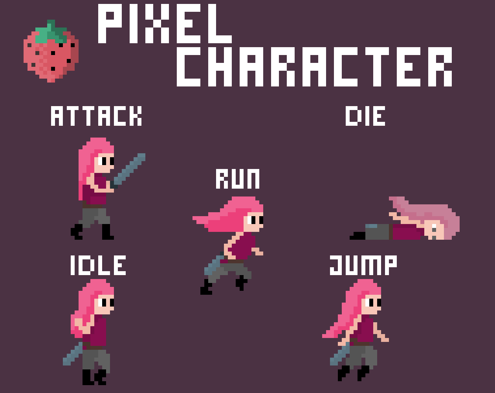

# 33. 2D Sprite Reference Sets

Idle/run/jump/attack/die sprite sets are a useful timing reference for key poses.

Back to the [catalog](../ANIMATIONS.md).

## Pictures

*Animated Pixel Character* by Fat Berry, [source page](https://fatberry.itch.io/free-pixel-character). Preview image, all rights with the creator.

*Free Platformer Character* by ludicarts, [source page](https://ludicarts.itch.io/free-platformer-character). Preview image, all rights with the creator.

## More previews (itch.io top results, credited)

Keyword-matched galleries. Click a gallery for 12 credited covers. These are search-style matches, not curated picks.

- [sprite-sheet + animation](../../previews/sprite-sheet-animation/README.md)
- [animated](../../previews/animated/README.md)

## Find more references
- [Google Images](https://www.google.com/search?tbm=isch&q=roblox+2D+Sprite+Reference+Sets+animation)
- [YouTube](https://www.youtube.com/results?search_query=roblox+2D+Sprite+Reference+Sets+animation)
- [Pinterest](https://www.pinterest.com/search/pins/?q=roblox+2D+Sprite+Reference+Sets+animation)
- [Behance](https://www.behance.net/search/projects?search=2D+Sprite+Reference+Sets+animation)
- [Dribbble](https://dribbble.com/search/2D+Sprite+Reference+Sets+animation)
