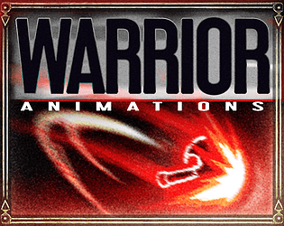
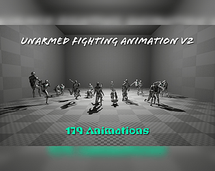
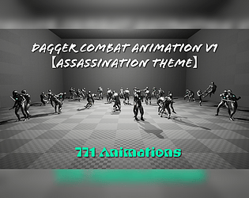
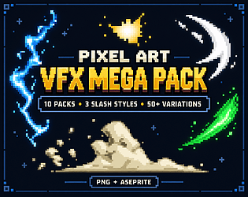

# itch.io top results: animation + combat

Top 12 listings on [https://itch.io/game-assets/tag-animation/tag-combat](https://itch.io/game-assets/tag-animation/tag-combat) when scraped on 2026-10-20. 315x250 cover thumbnails, credited per item; all rights remain with the creators. Thumbnails are shown only as design/sound-pack references, so click through for the real assets and check each licence.

**Universal Animation Library** by Quaternius: [https://quaternius.itch.io/universal-animation-library](https://quaternius.itch.io/universal-animation-library)

**Universal Animation Library 2** by Quaternius: [https://quaternius.itch.io/universal-animation-library-2](https://quaternius.itch.io/universal-animation-library-2)

**Pixel Art VFX - Warrior - FREE Version** by Frostwindz: [https://frostwindz.itch.io/pixel-art-skill-animations-warrior](https://frostwindz.itch.io/pixel-art-skill-animations-warrior)

**Unarmed Fighting Animation V2 (UE/Unity/Mixamo)** by Game Dev Hero: [https://gamedev-hero.itch.io/unarmed-fighting-animation-v2](https://gamedev-hero.itch.io/unarmed-fighting-animation-v2)

**Dagger Combat Animation V1 【Assassination Theme】(UE/Unity/Mixamo)** by Game Dev Hero: [https://gamedev-hero.itch.io/dagger-combat-animation-v1-assassination-theme](https://gamedev-hero.itch.io/dagger-combat-animation-v1-assassination-theme)

**One Handed Sword Animation V5 (UE/Unity/FBX)** by Game Dev Hero: [https://gamedev-hero.itch.io/onehanded-sword-animation-v5](https://gamedev-hero.itch.io/onehanded-sword-animation-v5)

**Pixel Art VFX Pack – 10 Effects** by Met.Pxl: [https://metpxl.itch.io/pixel-art-vfx-mega-pack](https://metpxl.itch.io/pixel-art-vfx-mega-pack)

**Pixel Art Lightning VFX – 8 Color Animation Pack** by Met.Pxl: [https://metpxl.itch.io/pixel-art-lightning-vfx-8-color-animation-pack](https://metpxl.itch.io/pixel-art-lightning-vfx-8-color-animation-pack)

**Pixel Art Bomb Explosion VFX – Animation Pack** by Met.Pxl: [https://metpxl.itch.io/pixel-art-bomb-explosion-vfx-animation-pack](https://metpxl.itch.io/pixel-art-bomb-explosion-vfx-animation-pack)

**Unarmed Fighting Animations V1 (UE/FBX)** by Game Dev Hero: [https://gamedev-hero.itch.io/unarmed-fighting-animations-v1-uefbx](https://gamedev-hero.itch.io/unarmed-fighting-animations-v1-uefbx)

**Motifect Combat Motion Pack** by Motifect: [https://motifect.itch.io/motifect-combat-motion-pack](https://motifect.itch.io/motifect-combat-motion-pack)

**Pixel Art Sword VFX – Attack & Slash Animation Pack** by Met.Pxl: [https://metpxl.itch.io/pixel-art-sword-vfx-attack-slash-animation-pack](https://metpxl.itch.io/pixel-art-sword-vfx-attack-slash-animation-pack)
