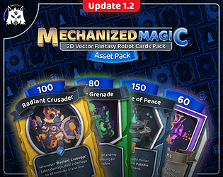
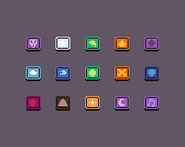
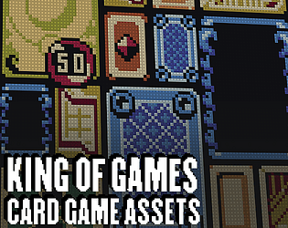
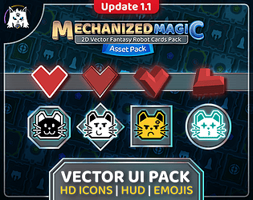
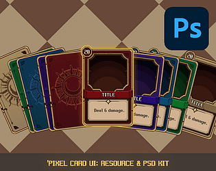

# itch.io top results: card-game + user-interface

Top 12 listings on [https://itch.io/game-assets/tag-card-game/tag-user-interface](https://itch.io/game-assets/tag-card-game/tag-user-interface) when scraped on 2026-10-20. 315x250 cover thumbnails, credited per item; all rights remain with the creators. Thumbnails are shown only as design/sound-pack references, so click through for the real assets and check each licence.

**Mechanized Magic: 2D Vector Cards Pack** by Dumivid: [https://dumivid.itch.io/mechanized-magic-2d-vector-fantasy-robot-cards-pack](https://dumivid.itch.io/mechanized-magic-2d-vector-fantasy-robot-cards-pack)

**Free Playing Cards Pixelart Asset Pack** by ELV Games: [https://elvgames.itch.io/playing-cards-pixelart-asset-pack](https://elvgames.itch.io/playing-cards-pixelart-asset-pack)

**UI Pack for a DeckBuilding Game** by Hanker: [https://argametina.itch.io/ui-pack-for-a-deckbuilding-game](https://argametina.itch.io/ui-pack-for-a-deckbuilding-game)

**KING OF GAMES | Card Game Assets** by CURSED OFFERINGS: [https://cursed-offerings.itch.io/king-of-games](https://cursed-offerings.itch.io/king-of-games)

**Mechanized Magic: Ultimate UI Pack** by Dumivid: [https://dumivid.itch.io/mechanized-magic-ui-pack](https://dumivid.itch.io/mechanized-magic-ui-pack)

**Pixel Card UI: Resource & PSD Kit** by IndigoLay: [https://indigolay.itch.io/pixelcardui](https://indigolay.itch.io/pixelcardui)

**Nice Card Game Template** by chicogames: [https://chicogames.itch.io/card-game-template](https://chicogames.itch.io/card-game-template)

**Fantasy Card Template** by Squibbls: [https://squibbls.itch.io/fct](https://squibbls.itch.io/fct)

**Card Deck (CC0)** by VerzatileDev: [https://verzatiledev.itch.io/card-deck](https://verzatiledev.itch.io/card-deck)

**Deck of Pixel Art Playing Cards** by Snoblin: [https://snoblin.itch.io/deck-of-playing-cards](https://snoblin.itch.io/deck-of-playing-cards)

**Card RPG) UI&Characters** by Sagak Art (Pururu): [https://sagak-art-pururu.itch.io/cardrpg-ui](https://sagak-art-pururu.itch.io/cardrpg-ui)

**Card Creator Toolkit (GUI)** by Penzilla: [https://penzilla.itch.io/card-creator-toolkit](https://penzilla.itch.io/card-creator-toolkit)
