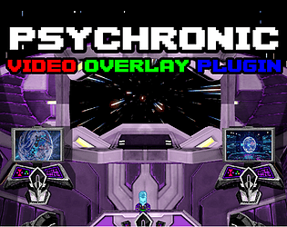
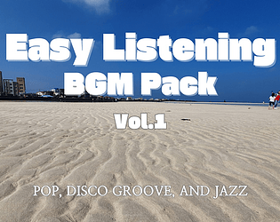
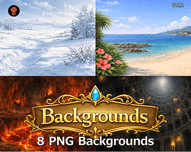
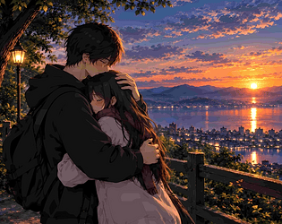
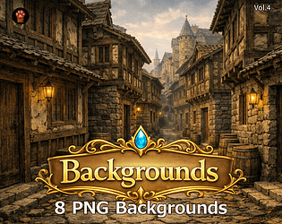
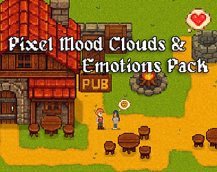

# itch.io top results: cutscene

Top 12 listings on [https://itch.io/game-assets/tag-cutscene](https://itch.io/game-assets/tag-cutscene) when scraped on 2026-10-20. 315x250 cover thumbnails, credited per item; all rights remain with the creators. Thumbnails are shown only as design/sound-pack references, so click through for the real assets and check each licence.

**Storytellers Character Assets (Lovely Knights)** by Socks: [https://lrdean-socks.itch.io/storytellers-character-assets-lovely-knights](https://lrdean-socks.itch.io/storytellers-character-assets-lovely-knights)

**Psychronic Video Overlay Plugin (MZ)** by Psychronic: [https://psychronic.itch.io/psychronic-video-overlay-plugin-mz](https://psychronic.itch.io/psychronic-video-overlay-plugin-mz)

**Easy Listening BGM Vol.1** by AuthorSeo: [https://authorseo.itch.io/easy-listening-bgm-vol1](https://authorseo.itch.io/easy-listening-bgm-vol1)

**Dialogue - No-Code Branching Dialogue for Godot 4** by selodev: [https://selodev.itch.io/dialogue-no-code-branching-dialogue-for-godot-4](https://selodev.itch.io/dialogue-no-code-branching-dialogue-for-godot-4)

**CS05 — Fantasy Inn & Shop Backgrounds** by Pixel Material Studio: [https://pixelartmaterial.itch.io/cs05-8-cutscene-backgrounds-png](https://pixelartmaterial.itch.io/cs05-8-cutscene-backgrounds-png)

**CS02 — Fantasy World Backgrounds** by Pixel Material Studio: [https://pixelartmaterial.itch.io/cs02-8-cutscene-backgrounds-png](https://pixelartmaterial.itch.io/cs02-8-cutscene-backgrounds-png)

**SAGA I: Trailers, Cutscenes, & Titles** by Steven Melin: [https://stevenmelin.itch.io/saga-i](https://stevenmelin.itch.io/saga-i)

**Romantic Dates & Confessions - Anime Event CG Pack Vol. 1** by StarlightVisuals: [https://starlightvisuals.itch.io/romantic-dates-confessions-anime-event-cg-pack-vol-1](https://starlightvisuals.itch.io/romantic-dates-confessions-anime-event-cg-pack-vol-1)

**CS04 — Fantasy Adventure Backgrounds** by Pixel Material Studio: [https://pixelartmaterial.itch.io/cs04-8-cutscene-backgrounds-png](https://pixelartmaterial.itch.io/cs04-8-cutscene-backgrounds-png)

**CS07 — Dark Fantasy Sanctuary Backgrounds** by Pixel Material Studio: [https://pixelartmaterial.itch.io/cs07-8-cutscene-backgrounds-png](https://pixelartmaterial.itch.io/cs07-8-cutscene-backgrounds-png)

**CS08 — Dark Fantasy Forbidden Chambers Backgrounds** by Pixel Material Studio: [https://pixelartmaterial.itch.io/cs08-8-cutscene-backgrounds-png](https://pixelartmaterial.itch.io/cs08-8-cutscene-backgrounds-png)

**Pixel Mood Clouds & Emotions Pack** by Biruk Okami: [https://biruk-okami.itch.io/pixel-mood-clouds-emotions-pack](https://biruk-okami.itch.io/pixel-mood-clouds-emotions-pack)
