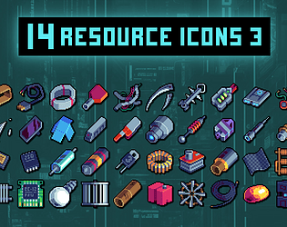
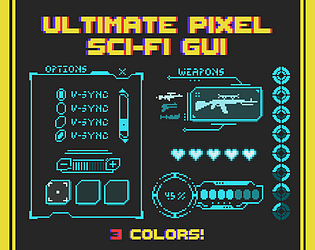
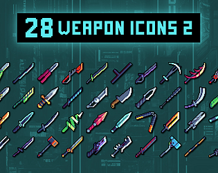
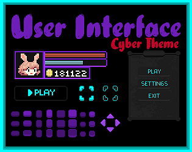
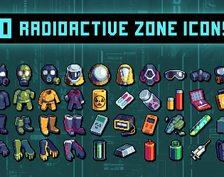

# itch.io top results: cyberpunk + user-interface

Top 12 listings on [https://itch.io/game-assets/tag-cyberpunk/tag-user-interface](https://itch.io/game-assets/tag-cyberpunk/tag-user-interface) when scraped on 2026-10-20. 315x250 cover thumbnails, credited per item; all rights remain with the creators. Thumbnails are shown only as design/sound-pack references, so click through for the real assets and check each licence.

**Free Mining Pixel Icons** by Free Game Assets (GUI, Sprite, Tilesets): [https://free-game-assets.itch.io/free-mining-pixel-3232-icons](https://free-game-assets.itch.io/free-mining-pixel-3232-icons)

**Free Cyberpunk Resource Pixel Icons** by Free Game Assets (GUI, Sprite, Tilesets): [https://free-game-assets.itch.io/free-cyberpunk-resource-pixel-art-3232-icons](https://free-game-assets.itch.io/free-cyberpunk-resource-pixel-art-3232-icons)

**Free Skill 32×32 Cyberpunk Icons Pixel Art** by Free Game Assets (GUI, Sprite, Tilesets): [https://free-game-assets.itch.io/free-skill-3232-icons-for-cyberpunk-game](https://free-game-assets.itch.io/free-skill-3232-icons-for-cyberpunk-game)

**Free Pixel Game UI for Cyberpunk** by Free Game Assets (GUI, Sprite, Tilesets): [https://free-game-assets.itch.io/free-gui-for-cyberpunk-pixel-art](https://free-game-assets.itch.io/free-gui-for-cyberpunk-pixel-art)

**Free Gun Icons 32×32** by Free Game Assets (GUI, Sprite, Tilesets): [https://free-game-assets.itch.io/free-guns-icon-3232-pixel-pack](https://free-game-assets.itch.io/free-guns-icon-3232-pixel-pack)

**UI buttons | Sound effects pack + GLITCHES** by pknm: [https://pknm.itch.io/ui-buttons-sound-effects-pack](https://pknm.itch.io/ui-buttons-sound-effects-pack)

![[SFX] Sci Fi UI Sound Effect Pack](07.png)

**[SFX] Sci Fi UI Sound Effect Pack** by JDSherbert: [https://jdsherbert.itch.io/sci-fi-ui-sfx-pack](https://jdsherbert.itch.io/sci-fi-ui-sfx-pack)

**Ultimate Pixel Sci-Fi UI set** by Finnmercury: [https://finnmercury.itch.io/sci-fi-ui-elements](https://finnmercury.itch.io/sci-fi-ui-elements)

**Free Melee Weapon Pixel Icons** by Free Game Assets (GUI, Sprite, Tilesets): [https://free-game-assets.itch.io/free-melee-weapon-pixel-icons-for-cyberpunk](https://free-game-assets.itch.io/free-melee-weapon-pixel-icons-for-cyberpunk)

**UI User Interface Pack - Cyber** by ToffeeCraft: [https://toffeecraft.itch.io/ui-user-interface-pack-cyber](https://toffeecraft.itch.io/ui-user-interface-pack-cyber)

**Glitch Noises** by Vladislav Zharkov: [https://vladislavzh.itch.io/glitch-noises](https://vladislavzh.itch.io/glitch-noises)

**Free Radioactive Zone Icons Pixel Art 32x32** by Free Game Assets (GUI, Sprite, Tilesets): [https://free-game-assets.itch.io/free-protective-suit-against-radiation-and-things-pixel-art-icons](https://free-game-assets.itch.io/free-protective-suit-against-radiation-and-things-pixel-art-icons)
