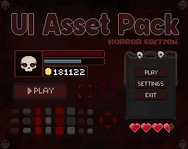
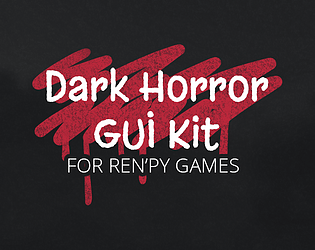
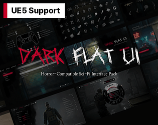
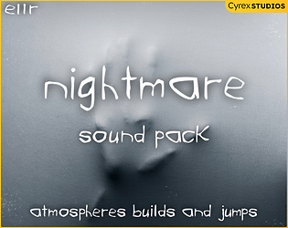
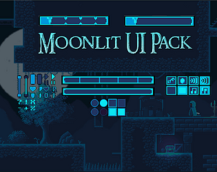

# itch.io top results: dark + user-interface

Top 12 listings on [https://itch.io/game-assets/tag-dark/tag-user-interface](https://itch.io/game-assets/tag-dark/tag-user-interface) when scraped on 2026-10-20. 315x250 cover thumbnails, credited per item; all rights remain with the creators. Thumbnails are shown only as design/sound-pack references, so click through for the real assets and check each licence.

**UI User Interface Pack - Horror** by ToffeeCraft: [https://toffeecraft.itch.io/ui-user-interface-pack-horror](https://toffeecraft.itch.io/ui-user-interface-pack-horror)

**SHADOW Series - Pixel Game UI - RPG HUD & Menu Pack** by escape-pixel: [https://escape-pixel.itch.io/shadow-series-pixel-game-ui](https://escape-pixel.itch.io/shadow-series-pixel-game-ui)

**Grindhaus - Horror Icon Set** by beachboogeyman: [https://beachboogeyman.itch.io/horror-icon-set-grind-haus](https://beachboogeyman.itch.io/horror-icon-set-grind-haus)

**Fantasy RPG UI Pack** by Moon Tribe: [https://moon-tribe.itch.io/fantasy-rpg-ui-pack](https://moon-tribe.itch.io/fantasy-rpg-ui-pack)

**SHADOW Series - Pixel UI - Dark Fantasy GUI Pack** by escape-pixel: [https://escape-pixel.itch.io/shadow-series-pixel-ui](https://escape-pixel.itch.io/shadow-series-pixel-ui)

**Ren'Py Horror/Dark UI Kit** by __ess__ VN Assets: [https://ess-vn-assets.itch.io/renpy-horror-dark-ui-kit](https://ess-vn-assets.itch.io/renpy-horror-dark-ui-kit)

**Shadow Mines - Free 2D Game Asset Pack** by waxx: [https://waxx.itch.io/shadow-mines-asset-pack](https://waxx.itch.io/shadow-mines-asset-pack)

**Dark UI Kit + Unreal Project** by IndigoLay: [https://indigolay.itch.io/dark-game-ui-kit](https://indigolay.itch.io/dark-game-ui-kit)

![Classic Clean UI (Ren'Py GUI Kit) [Supports multiple color themes]](09.png)

**Classic Clean UI (Ren'Py GUI Kit) [Supports multiple color themes]** by NeonStarz: [https://neonstarz.itch.io/classic-clean-ui-renpy-gui-kit](https://neonstarz.itch.io/classic-clean-ui-renpy-gui-kit)

**Assets: ASL Styles Photoshop #1** by Wenrexa: [https://wenrexa.itch.io/different-styles-buttons](https://wenrexa.itch.io/different-styles-buttons)

**Nightmare: Horror Sound Pack** by Cyrex Studios: [https://cyrex-studios.itch.io/nightmare-pack](https://cyrex-studios.itch.io/nightmare-pack)

**Moonlit UI and Button Pack - Part of the Moonlit Platformer Series** by Sebbyspoons: [https://sebbyspoons.itch.io/moonlit-ui-set](https://sebbyspoons.itch.io/moonlit-ui-set)
