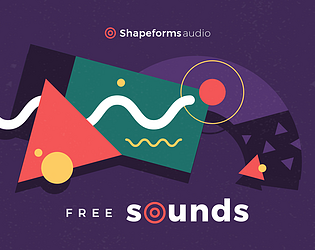
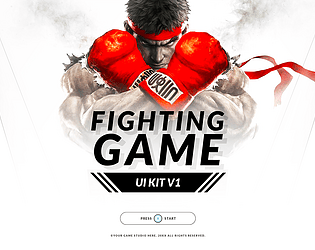
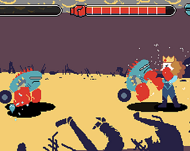
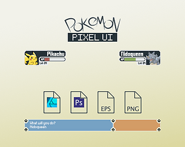
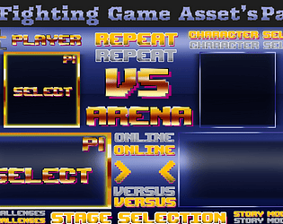
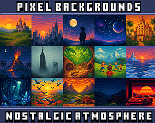
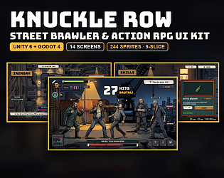
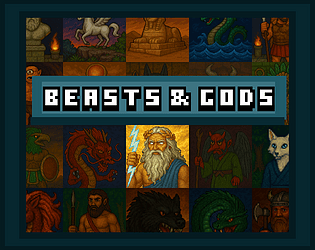

# itch.io top results: fighting + user-interface

Top 12 listings on [https://itch.io/game-assets/tag-fighting/tag-user-interface](https://itch.io/game-assets/tag-fighting/tag-user-interface) when scraped on 2026-10-20. 315x250 cover thumbnails, credited per item; all rights remain with the creators. Thumbnails are shown only as design/sound-pack references, so click through for the real assets and check each licence.

**FREE Pixel Combat SFX** by Helton Yan: [https://heltonyan.itch.io/pixelcombat](https://heltonyan.itch.io/pixelcombat)

**Shapeforms Audio Free Sound Effects** by Shapeforms: [https://shapeforms.itch.io/shapeforms-audio-free-sfx](https://shapeforms.itch.io/shapeforms-audio-free-sfx)

**FIGHTING GAME UIKIT-V1** by rupertBastos: [https://rupertbastos.itch.io/fighting-game-uikit-v1](https://rupertbastos.itch.io/fighting-game-uikit-v1)

**Beat em Up Graphics Pack** by RetroDima: [https://retrodima.itch.io/beat-em-up-graphics-pack](https://retrodima.itch.io/beat-em-up-graphics-pack)

**Pokemon Style UI Kit/ Asset Pack (PixelArt)** by Tavare Studio: [https://tavare-studio.itch.io/pokemon-style-ui-kit](https://tavare-studio.itch.io/pokemon-style-ui-kit)

**UI Fighting Game Asset’s Pack** by Pandora Entertainment: [https://pandoraentertainment.itch.io/ui-fighting-game-assets-pack](https://pandoraentertainment.itch.io/ui-fighting-game-assets-pack)

**199 DETAILED WORLD FLAGS (16x16px) for your game or project.** by TriariusKonstantinus: [https://triariuskonstantinus.itch.io/199-detailed-world-flags-16x16px-for-your-game-or-project](https://triariuskonstantinus.itch.io/199-detailed-world-flags-16x16px-for-your-game-or-project)

**FIGHTING GAME UIKIT PACK-V1** by rupertBastos: [https://rupertbastos.itch.io/fighting-game-uikit-pack-v1](https://rupertbastos.itch.io/fighting-game-uikit-pack-v1)

**15 128x128 nostalgic backgrounds** by Kelano Studio: [https://kelano-studio.itch.io/15-128x128-handpixeled-nostalgic-backgrounds](https://kelano-studio.itch.io/15-128x128-handpixeled-nostalgic-backgrounds)

**Knuckle Row – Street Brawler & Beat 'Em Up Action RPG UI Kit** by v2kid: [https://v2kid.itch.io/knuckle-row-street-brawler-ui-kit](https://v2kid.itch.io/knuckle-row-street-brawler-ui-kit)

**Complete Gameboy  Color UI and Menu Set** by goblinspire: [https://goblinspire.itch.io/game-boy-color-style-ui-and-menu-pack](https://goblinspire.itch.io/game-boy-color-style-ui-and-menu-pack)

**Beasts & Gods** by Kelano Studio: [https://kelano-studio.itch.io/beasts-gods](https://kelano-studio.itch.io/beasts-gods)
