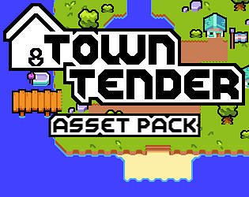
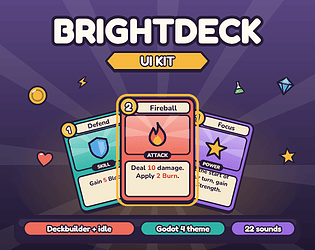
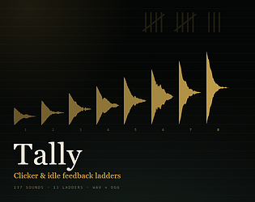
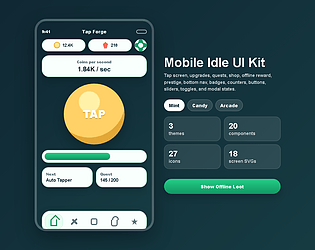
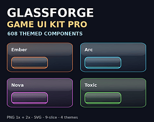
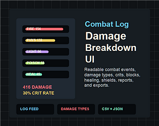
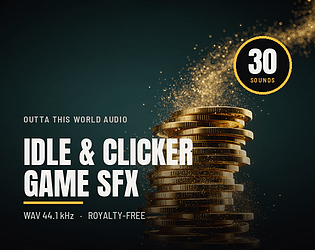

# itch.io top results: idle + user-interface

Top 12 listings on [https://itch.io/game-assets/tag-idle/tag-user-interface](https://itch.io/game-assets/tag-idle/tag-user-interface) when scraped on 2026-10-20. 315x250 cover thumbnails, credited per item; all rights remain with the creators. Thumbnails are shown only as design/sound-pack references, so click through for the real assets and check each licence.

**Casual Mobile Game UI Kit + 260 icons** by SunGraphica: [https://sungraphica.itch.io/casual-mobile-game-ui-kit-260-icons](https://sungraphica.itch.io/casual-mobile-game-ui-kit-260-icons)

**Town Tender - Asset pack** by Tetraminose: [https://tetraminose.itch.io/town-tender-asset-pack](https://tetraminose.itch.io/town-tender-asset-pack)

**Free Idle and Clicker Sounds - 8 Royalty-Free Click and Coin SFX** by Outta This World Audio: [https://moneywithjjcom.itch.io/free-idle-clicker-sounds](https://moneywithjjcom.itch.io/free-idle-clicker-sounds)

**Brightdeck UI Kit: Deckbuilder & Idle Game GUI + Godot 4 Theme** by DadddyDarko: [https://dadddydarko.itch.io/brightdeck-ui-kit](https://dadddydarko.itch.io/brightdeck-ui-kit)

**Tally — Clicker and Idle Feedback Ladders** by CSAF — Core Systems Asset Factory: [https://csaf.itch.io/tally-clicker-feedback](https://csaf.itch.io/tally-clicker-feedback)

**Free Idle & Tycoon UI Sampler – 8 Game-Ready Assets** by GoldenForgeStudios: [https://goldenforgestudios.itch.io/golden-forge-free-idle-tycoon-ui-sampler](https://goldenforgestudios.itch.io/golden-forge-free-idle-tycoon-ui-sampler)

**Mobile Idle & Clicker UI Kit – 18 Screens, 3 Themes + Godot 4** by Template Foundry: [https://mtw1man2.itch.io/mobile-idle-game-ui-kit-premium-casual-upgrade-progression-screens](https://mtw1man2.itch.io/mobile-idle-game-ui-kit-premium-casual-upgrade-progression-screens)

**Game UI Kit - 608 Components, PNG, SVG and 9-Slice - Glassforge** by Dmitriy o_HET: [https://o-het.itch.io/glassforge-ember-ui-pack](https://o-het.itch.io/glassforge-ember-ui-pack)

**Combat Log + Damage Breakdown UI** by Template Foundry: [https://mtw1man2.itch.io/combat-log-damage-breakdown-ui](https://mtw1man2.itch.io/combat-log-damage-breakdown-ui)

**Idle Gamer Simulator — Glossy Arcade GUI Kit (200+ elements)** by AuraSoft: [https://auragamestudio.itch.io/idle-gamer-simulator-glossy-arcade-gui-kit-200-elements](https://auragamestudio.itch.io/idle-gamer-simulator-glossy-arcade-gui-kit-200-elements)

**Idle and Clicker Game SFX - 30 Click, Coin and Upgrade Sounds** by Outta This World Audio: [https://moneywithjjcom.itch.io/idle-clicker](https://moneywithjjcom.itch.io/idle-clicker)

**Idle & Tycoon UI Starter Pack – 48 Game-Ready UI Assets** by GoldenForgeStudios: [https://goldenforgestudios.itch.io/juicy-idle-web3-ui-kit](https://goldenforgestudios.itch.io/juicy-idle-web3-ui-kit)
