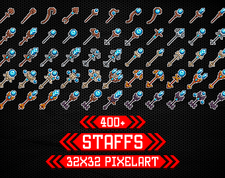
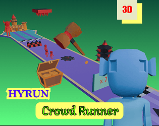
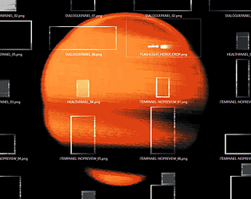

# itch.io top results: low-poly + user-interface

Top 12 listings on [https://itch.io/game-assets/tag-low-poly/tag-user-interface](https://itch.io/game-assets/tag-low-poly/tag-user-interface) when scraped on 2026-10-20. 315x250 cover thumbnails, credited per item; all rights remain with the creators. Thumbnails are shown only as design/sound-pack references, so click through for the real assets and check each licence.

**ElvGames All-Access Pass** by ELV Games: [https://elvgames.itch.io/elvgames-all-access-pass](https://elvgames.itch.io/elvgames-all-access-pass)

**Ren'Py Hypercard Framework** by Eliot Gardepe: [https://egardepe.itch.io/hypercard](https://egardepe.itch.io/hypercard)

**Hypercard Graphics Pack** by Eliot Gardepe: [https://egardepe.itch.io/hypercardgraphics](https://egardepe.itch.io/hypercardgraphics)

**Retro Dialogue SFX Pack** by Leohpaz: [https://leohpaz.itch.io/retro-dialogue-sfx-pack](https://leohpaz.itch.io/retro-dialogue-sfx-pack)

**Staff Icons 32x32 Pixelart** by ELV Games: [https://elvgames.itch.io/staff-item-icons-32x32-pixelart](https://elvgames.itch.io/staff-item-icons-32x32-pixelart)

**PSX & Retro  ♦ UI & Menu Sound Effects (Vol.1)** by Nomagician • Music & SFX: [https://nomagician.itch.io/psx-menu-ui-sfx](https://nomagician.itch.io/psx-menu-ui-sfx)

![Interactive 2D World Map for unity [based on vector graphics]](07.png)

**Interactive 2D World Map for unity [based on vector graphics]** by Naoufel: [https://naoufelbougueroua.itch.io/interactive-worldmap](https://naoufelbougueroua.itch.io/interactive-worldmap)

**HYRUN : Crowd Runner Hyper Casual Game Asset Pack** by Standout 7: [https://standout7.itch.io/crowd-runner](https://standout7.itch.io/crowd-runner)

**PS1 HORROR UI (COMPLETE)** by ROHHSA: [https://rohhsa.itch.io/psx-ui-2](https://rohhsa.itch.io/psx-ui-2)

![Cartoon UI Icon Pack Vol. 1 [Update]](10.png)

**Cartoon UI Icon Pack Vol. 1 [Update]** by K7_42: [https://k7-42.itch.io/cartoon-ui-icon-pack-vol-1](https://k7-42.itch.io/cartoon-ui-icon-pack-vol-1)

**Rugged Work Phone - 3D Model + Music Player UI - glTF, FBX, Godot 4** by Out of Tokens Studio: [https://outoftokensstudio.itch.io/rugged-work-phone](https://outoftokensstudio.itch.io/rugged-work-phone)

**Vector Pack v2** by Cyberdelic: [https://cyberdelicdev.itch.io/vector-pack-v2](https://cyberdelicdev.itch.io/vector-pack-v2)
