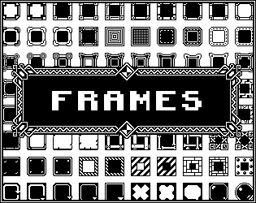
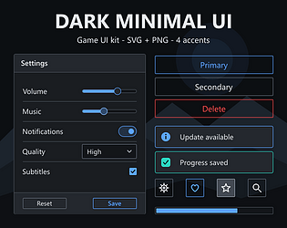
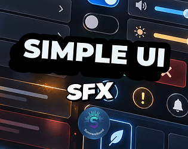
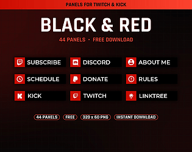

# itch.io top results: minimal + user-interface

Top 12 listings on [https://itch.io/game-assets/tag-minimal/tag-user-interface](https://itch.io/game-assets/tag-minimal/tag-user-interface) when scraped on 2026-10-20. 315x250 cover thumbnails, credited per item; all rights remain with the creators. Thumbnails are shown only as design/sound-pack references, so click through for the real assets and check each licence.

**Frames** by piiixl: [https://piiixl.itch.io/frames](https://piiixl.itch.io/frames)

**Mega Pack** by piiixl: [https://piiixl.itch.io/mega-pack](https://piiixl.itch.io/mega-pack)

**8x8px 1000+** by piiixl: [https://piiixl.itch.io/8x8px](https://piiixl.itch.io/8x8px)

**Modern Royal Purple GUI** by Comp-3 Interactive: [https://comp3interactive.itch.io/modern-royal-purple-gui](https://comp3interactive.itch.io/modern-royal-purple-gui)

**Dark Minimal UI - FREE Sample (SVG + PNG)** by StationSupply: [https://stationsupply.itch.io/dark-minimal-ui-kit-free-sample](https://stationsupply.itch.io/dark-minimal-ui-kit-free-sample)

**Dark Minimal UI - Game UI Kit (SVG + PNG)** by StationSupply: [https://stationsupply.itch.io/dark-minimal-ui-kit](https://stationsupply.itch.io/dark-minimal-ui-kit)

**Op Art Interface Godot Theme** by GalacticLake: [https://galacticlake.itch.io/op-art-interface-godot-theme](https://galacticlake.itch.io/op-art-interface-godot-theme)

**Minimal UI Notifications – 20 Clean & Modern Interface Sounds** by SoundShelf Studio: [https://soundshelf.itch.io/minimal-ui-notifications-20-clean-modern-interface-sounds](https://soundshelf.itch.io/minimal-ui-notifications-20-clean-modern-interface-sounds)

**Clean Modern UI Kit - Dark (241 parts)** by Taproot Solutions LLC: [https://taproot-solutions-llc.itch.io/clean-modern-ui-kit-dark](https://taproot-solutions-llc.itch.io/clean-modern-ui-kit-dark)

**Simple & Minimal UI Sound Effects – Game Interface SFX** by SummersSound: [https://summerssound.itch.io/simple-minimal-ui-sound-effects-game-interface-sfx](https://summerssound.itch.io/simple-minimal-ui-sound-effects-game-interface-sfx)

**Black & Red Twitch Panels** by fancyshards: [https://fancyshards.itch.io/black-and-red-twitch-panels](https://fancyshards.itch.io/black-and-red-twitch-panels)

**Swiss Minimal - Godot UI Theme** by GalacticLake: [https://galacticlake.itch.io/swiss-minimal-godot-theme](https://galacticlake.itch.io/swiss-minimal-godot-theme)
