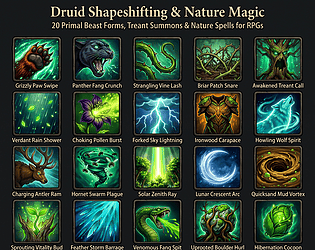
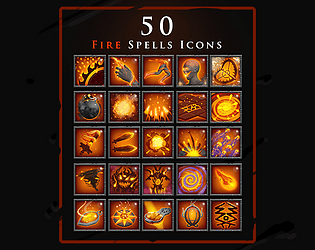

# itch.io top results: nature + user-interface

Top 12 listings on [https://itch.io/game-assets/tag-nature/tag-user-interface](https://itch.io/game-assets/tag-nature/tag-user-interface) when scraped on 2026-10-20. 315x250 cover thumbnails, credited per item; all rights remain with the creators. Thumbnails are shown only as design/sound-pack references, so click through for the real assets and check each licence.

**Assets Free: UI Casual Interface Nature** by Wenrexa: [https://wenrexa.itch.io/assets-ui-flowers](https://wenrexa.itch.io/assets-ui-flowers)

**UI Sound Pack** by Cyrex Studios: [https://cyrex-studios.itch.io/ui-sound-pack](https://cyrex-studios.itch.io/ui-sound-pack)

**Assets: 2D Crystal Sprites** by Wenrexa: [https://wenrexa.itch.io/crystals-signs](https://wenrexa.itch.io/crystals-signs)

**Assets: Free GUI Casual Nature** by Wenrexa: [https://wenrexa.itch.io/gui-nature](https://wenrexa.itch.io/gui-nature)

![Assets: Sprites Forest [Trees, Backgrounds] #2](05.jpg)

**Assets: Sprites Forest [Trees, Backgrounds] #2** by Wenrexa: [https://wenrexa.itch.io/background-fast-game](https://wenrexa.itch.io/background-fast-game)

**Floral Fantasy Pixel Font "Pæonia"** by Valiegraphie: [https://valiegraphie.itch.io/art-nouveau-pixel-font-paeonia](https://valiegraphie.itch.io/art-nouveau-pixel-font-paeonia)

**20 Druid Shapeshifting & Nature Magic - Dark Fantasy RPG Icons (Vol. 25)** by M-Xing Studio: [https://meng-xing.itch.io/druid-shapeshifting-nature-magic-rpg-icons](https://meng-xing.itch.io/druid-shapeshifting-nature-magic-rpg-icons)

**Free UI Nature Pack** by Qiuro: [https://qiuro.itch.io/free-uinature-pack](https://qiuro.itch.io/free-uinature-pack)

**Frutiger Aero UI – Godot Theme** by GalacticLake: [https://galacticlake.itch.io/frutiger-aero-ui-godot-theme](https://galacticlake.itch.io/frutiger-aero-ui-godot-theme)

**Game Interface: Wood** by moxica: [https://moxica.itch.io/game-interface-wood](https://moxica.itch.io/game-interface-wood)

**Forest Emerald UI Kit - 44 PNG interface elements** by uiforge: [https://uiforge.itch.io/forest-emerald-ui-kit](https://uiforge.itch.io/forest-emerald-ui-kit)

**50 RPG Magic Fire Spell Icons** by dealerdesign: [https://dealerdesign.itch.io/50-rpg-magic-fire-spell-icons](https://dealerdesign.itch.io/50-rpg-magic-fire-spell-icons)
