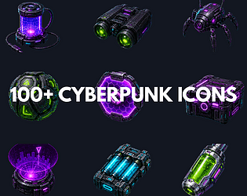
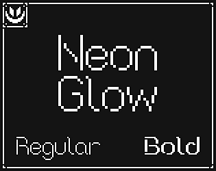
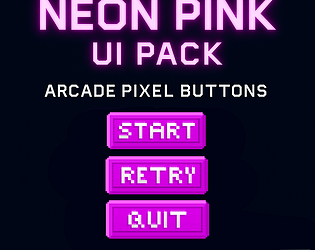

# itch.io top results: neon + user-interface

Top 12 listings on [https://itch.io/game-assets/tag-neon/tag-user-interface](https://itch.io/game-assets/tag-neon/tag-user-interface) when scraped on 2026-10-20. 315x250 cover thumbnails, credited per item; all rights remain with the creators. Thumbnails are shown only as design/sound-pack references, so click through for the real assets and check each licence.

![Assets Free Abstract Backgrounds [+202]](01.jpg)

**Assets Free Abstract Backgrounds [+202]** by Wenrexa: [https://wenrexa.itch.io/abstractbq](https://wenrexa.itch.io/abstractbq)

**Healzone pixel & classic fonts** by thUg-inc: [https://thug-inc.itch.io/healzone-pixel-fonts](https://thug-inc.itch.io/healzone-pixel-fonts)

**Fonts: digital LED clock** by moxica: [https://moxica.itch.io/fonts-digital-clock](https://moxica.itch.io/fonts-digital-clock)

**Cyan Neon UI Pack - Pixel Arcade Buttons** by Uryon Games: [https://uryon-games.itch.io/cyan-neon-ui-pack](https://uryon-games.itch.io/cyan-neon-ui-pack)

**Cyberpunk HUD UI Kit - Vol. 1** by DJY66 | Cyberpunk UI: [https://djy66.itch.io/cyberpunk-hud-ui-kit-vol-1](https://djy66.itch.io/cyberpunk-hud-ui-kit-vol-1)

**NEONIX UI — 500 Modern Neon Game UI Assets** by Gonken Games: [https://gonkengames.itch.io/neonix-ui-500-modern-neon-game-ui-assets](https://gonkengames.itch.io/neonix-ui-500-modern-neon-game-ui-assets)

**100 Cyberpunk Neon Items & Loot Icons - RPG Asset Pack** by GameReadyPixels: [https://gamereadypixels.itch.io/100-cyberpunk-neon-loot-items-icons-2d-rpg-asset-pack](https://gamereadypixels.itch.io/100-cyberpunk-neon-loot-items-icons-2d-rpg-asset-pack)

**Neon Glow - Pixel Font** by Bragorn: [https://bragorn.itch.io/neon-glow-pixel-font](https://bragorn.itch.io/neon-glow-pixel-font)

**Neon Pink UI Pack – Pixel Arcade Buttons** by Uryon Games: [https://uryon-games.itch.io/neon-pink-ui-pack-pixel-arcade-buttons](https://uryon-games.itch.io/neon-pink-ui-pack-pixel-arcade-buttons)

**Neon UI Kit Lite (19 Pixel Art Pieces, Free · No AI)** by Willosuna: [https://willosuna.itch.io/neon-ui-kit-lite](https://willosuna.itch.io/neon-ui-kit-lite)

**Cyberpunk UI Asset Pack v1** by DoDoCat: [https://ckgndodocat.itch.io/cyberpunk-ui-asset-pack-v1](https://ckgndodocat.itch.io/cyberpunk-ui-asset-pack-v1)

![[FREE] Cyberpunk UI Starter Kit & 4K Backgrounds](12.jpg)

**[FREE] Cyberpunk UI Starter Kit & 4K Backgrounds** by DJY66 | Cyberpunk UI: [https://djy66.itch.io/free-sample-cyberpunk-slums-vol3-4k-backgrounds](https://djy66.itch.io/free-sample-cyberpunk-slums-vol3-4k-backgrounds)
