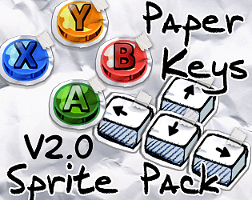
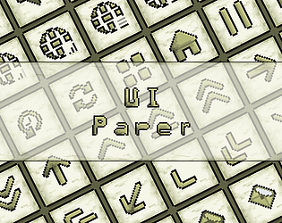
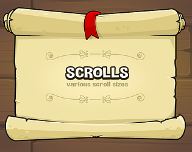
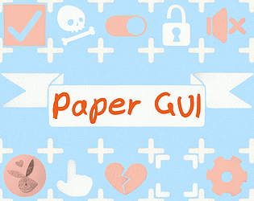
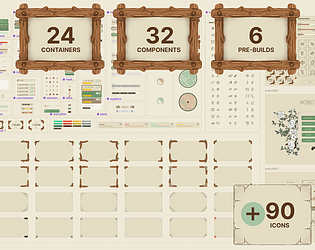
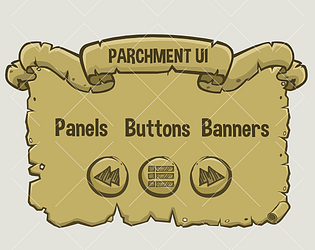
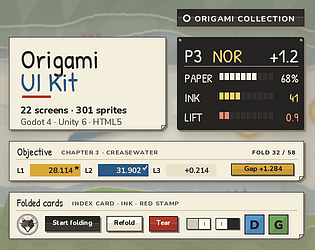
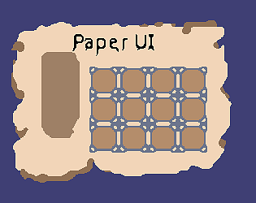

# itch.io top results: paper + user-interface

Top 12 listings on [https://itch.io/game-assets/tag-paper/tag-user-interface](https://itch.io/game-assets/tag-paper/tag-user-interface) when scraped on 2026-10-20. 315x250 cover thumbnails, credited per item; all rights remain with the creators. Thumbnails are shown only as design/sound-pack references, so click through for the real assets and check each licence.

**Paper Keys Sprite Pack V2.0** by U-GameZ: [https://u-gamez.itch.io/paper-keys-sprite-pack](https://u-gamez.itch.io/paper-keys-sprite-pack)

**UI: 01 Paper Theme** by Admurin: [https://admurin.itch.io/ui-paper-theme](https://admurin.itch.io/ui-paper-theme)

**Scroll kit** by Robert Brooks - gamedeveloperstudio.com: [https://gamedeveloperstudio.itch.io/scroll-kit](https://gamedeveloperstudio.itch.io/scroll-kit)

**Found Notes & Documents Kit – Pixel Paper Templates, Horror Notes & a Note Reader** by lesed: [https://lesed.itch.io/found-notes-documents-kit](https://lesed.itch.io/found-notes-documents-kit)

**Paper GUI** by ErinBrume: [https://erinbrume.itch.io/paper-gui](https://erinbrume.itch.io/paper-gui)

**Wood & Paper - UI Kit** by createdbyjerry: [https://createdbyjerry.itch.io/wood-paper-ui-kit](https://createdbyjerry.itch.io/wood-paper-ui-kit)

**Parchment UI** by Robert Brooks - gamedeveloperstudio.com: [https://gamedeveloperstudio.itch.io/parchment-ui](https://gamedeveloperstudio.itch.io/parchment-ui)

**Paper & Ink – GUI kit for Ren'Py** by Juliusschmidt: [https://juliusschmidt.itch.io/paper-and-ink-renpy-gui](https://juliusschmidt.itch.io/paper-and-ink-renpy-gui)

**Origami UI Kit - HUD + Strategy - 22 Screens - Godot, Unity, HTML5** by Out of Tokens Studio: [https://outoftokensstudio.itch.io/origami-ui-kit](https://outoftokensstudio.itch.io/origami-ui-kit)

**Horror Paper UI Kit** by Dell Create: [https://fadelpermanaa.itch.io/horror-paper-ui-kit](https://fadelpermanaa.itch.io/horror-paper-ui-kit)

**Simple Pixel Paper UI kit** by inkle: [https://inklestudios.itch.io/paper-ui-kit](https://inklestudios.itch.io/paper-ui-kit)

**Horror UI Kit - Dead Ward (251 parts)** by Taproot Solutions LLC: [https://taproot-solutions-llc.itch.io/horror-ui-kit-dead-ward](https://taproot-solutions-llc.itch.io/horror-ui-kit-dead-ward)
