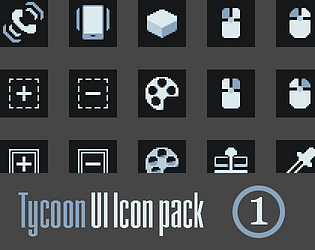
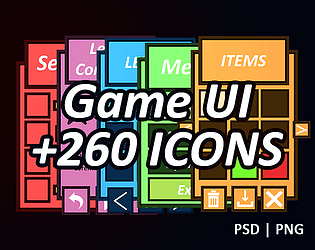
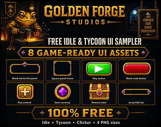
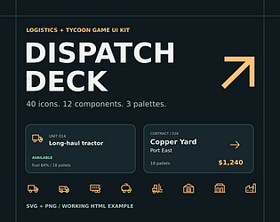

# itch.io top results: tycoon + user-interface

Top 12 listings on [https://itch.io/game-assets/tag-tycoon/tag-user-interface](https://itch.io/game-assets/tag-tycoon/tag-user-interface) when scraped on 2026-10-20. 315x250 cover thumbnails, credited per item; all rights remain with the creators. Thumbnails are shown only as design/sound-pack references, so click through for the real assets and check each licence.

**600 clean and minimal game Icons ultimate pack** by SunGraphica: [https://sungraphica.itch.io/minimal-game-icons-pack](https://sungraphica.itch.io/minimal-game-icons-pack)

**Line Game Icons Ultimate collection** by SunGraphica: [https://sungraphica.itch.io/line-game-icons-ultimate-collection](https://sungraphica.itch.io/line-game-icons-ultimate-collection)

**Neon Sci-Fi Interface Kit** by SunGraphica: [https://sungraphica.itch.io/neon-sci-fi-interface-kit](https://sungraphica.itch.io/neon-sci-fi-interface-kit)

**Casual Mobile Game UI Kit + 260 icons** by SunGraphica: [https://sungraphica.itch.io/casual-mobile-game-ui-kit-260-icons](https://sungraphica.itch.io/casual-mobile-game-ui-kit-260-icons)

**Modern and minimal game UI kit + 260 Icons** by SunGraphica: [https://sungraphica.itch.io/modern-and-minimal-game-ui-kit-260-icons](https://sungraphica.itch.io/modern-and-minimal-game-ui-kit-260-icons)

**Game asset UI pack + Icon collection** by SunGraphica: [https://sungraphica.itch.io/game-asset-ui-pack-icon-collection](https://sungraphica.itch.io/game-asset-ui-pack-icon-collection)

**Tycoon UI Icon pack** by GregorMack: [https://gregormack.itch.io/tycoon-ui-icon-pack](https://gregormack.itch.io/tycoon-ui-icon-pack)

**Simple Flat Game Interface Kit** by SunGraphica: [https://sungraphica.itch.io/simple-flat-game-interface-kit](https://sungraphica.itch.io/simple-flat-game-interface-kit)

**Free Idle & Tycoon UI Sampler – 8 Game-Ready Assets** by GoldenForgeStudios: [https://goldenforgestudios.itch.io/golden-forge-free-idle-tycoon-ui-sampler](https://goldenforgestudios.itch.io/golden-forge-free-idle-tycoon-ui-sampler)

**Mobile Idle & Clicker UI Kit – 18 Screens, 3 Themes + Godot 4** by Template Foundry: [https://mtw1man2.itch.io/mobile-idle-game-ui-kit-premium-casual-upgrade-progression-screens](https://mtw1man2.itch.io/mobile-idle-game-ui-kit-premium-casual-upgrade-progression-screens)

**Dispatch Deck** by Routy: [https://routecon.itch.io/dispatch-deck](https://routecon.itch.io/dispatch-deck)

**Idle & Tycoon UI Starter Pack – 48 Game-Ready UI Assets** by GoldenForgeStudios: [https://goldenforgestudios.itch.io/juicy-idle-web3-ui-kit](https://goldenforgestudios.itch.io/juicy-idle-web3-ui-kit)
