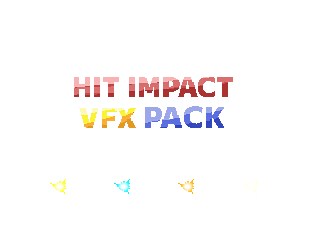
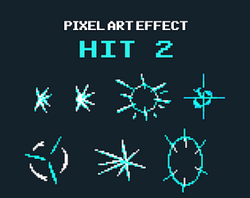
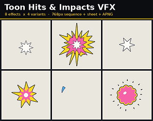

# itch.io top results: vfx + hit

Top 12 listings on [https://itch.io/game-assets/tag-vfx/tag-hit](https://itch.io/game-assets/tag-vfx/tag-hit) when scraped on 2026-10-20. 315x250 cover thumbnails, credited per item; all rights remain with the creators. Thumbnails are shown only as design/sound-pack references, so click through for the real assets and check each licence.

**Pixel Art VFX - Impacts - FREE Version** by Frostwindz: [https://frostwindz.itch.io/pixel-art-vfx-impacts-free-version](https://frostwindz.itch.io/pixel-art-vfx-impacts-free-version)

**VFX - HIT IMPACT - Pixel Art Effects** by kiddolink: [https://kiddolink.itch.io/vfx-fx-hit-impact-pixel-art](https://kiddolink.itch.io/vfx-fx-hit-impact-pixel-art)

**Combat Effects  6– 2D Pixel Art VFX Pack** by Pozac: [https://pozac.itch.io/combat-effects-6-2d-pixel-art-vfx-pack](https://pozac.itch.io/combat-effects-6-2d-pixel-art-vfx-pack)

**Hit VFX Pack - 30 Stylized Impact Effects for Godot 4** by berrryhibiscus: [https://berryhibiscus.itch.io/hit-vfx-pack-30-stylized-impact-effects-for-godot-4](https://berryhibiscus.itch.io/hit-vfx-pack-30-stylized-impact-effects-for-godot-4)

**Hit Impact Effects** by Travis Game Assets: [https://travis-game-assets.itch.io/hit-impact-effects](https://travis-game-assets.itch.io/hit-impact-effects)

**Pixel Art Hit Impact VFX - 8 Color Animation Pack** by Met.Pxl: [https://metpxl.itch.io/metpxlitchiopixel-art-hit-impact-vfx](https://metpxl.itch.io/metpxlitchiopixel-art-hit-impact-vfx)

**Pixel Combat & Hit FX – 15 Animated Effects** by lesed: [https://lesed.itch.io/pixel-combat-hit-fx](https://lesed.itch.io/pixel-combat-hit-fx)

**Hit - Effect Pixel Art** by sanctumpixel: [https://sanctumpixel.itch.io/hit-effect-pixel-art](https://sanctumpixel.itch.io/hit-effect-pixel-art)

**Hit 2 - Effect Pixel Art** by sanctumpixel: [https://sanctumpixel.itch.io/hit-2-effect-pixel-art](https://sanctumpixel.itch.io/hit-2-effect-pixel-art)

**Toon Hits & Impacts VFX - Vol. 1 (2D)** by Taproot Solutions LLC: [https://taproot-solutions-llc.itch.io/toon-hits-impacts-vfx-vol1](https://taproot-solutions-llc.itch.io/toon-hits-impacts-vfx-vol1)

**Blood & Hit Feedback VFX - Vol. 1 (2D)** by Taproot Solutions LLC: [https://taproot-solutions-llc.itch.io/blood-hit-feedback-vfx-vol1](https://taproot-solutions-llc.itch.io/blood-hit-feedback-vfx-vol1)

**Flintspark FX Lite - 5 Free Status, Hit & Loot VFX with Start, Loop & End (Godot 4 & Unity)** by spareminute: [https://spareminute.itch.io/flintspark-fx-lite](https://spareminute.itch.io/flintspark-fx-lite)
