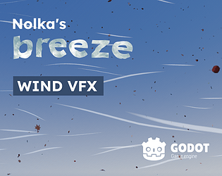
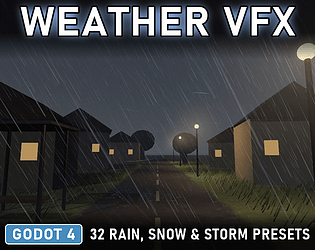
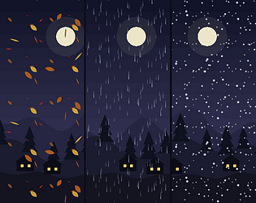
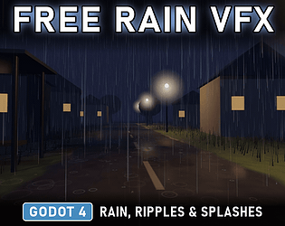

# itch.io top results: vfx + weather

Top 12 listings on [https://itch.io/game-assets/tag-vfx/tag-weather](https://itch.io/game-assets/tag-vfx/tag-weather) when scraped on 2026-10-20. 315x250 cover thumbnails, credited per item; all rights remain with the creators. Thumbnails are shown only as design/sound-pack references, so click through for the real assets and check each licence.

**40 Pixel Art Atmospheric VFX Pack** by Alenia Studios: [https://alenia-studios.itch.io/pixel-art-atmospheric-vfx-pack](https://alenia-studios.itch.io/pixel-art-atmospheric-vfx-pack)

**General Weather Complete Pack - 2D Weather VFX + Bonus SFX-Godot-Ready** by obssidian-art: [https://obssidian-art.itch.io/general-weather-complete-pack-godot-ready](https://obssidian-art.itch.io/general-weather-complete-pack-godot-ready)

**Unity AtmosphereFX: Stylized Nature Particles Pack** by EmaceArt: [https://emaceart.itch.io/atmospherefx-stylized-nature-particles-pack](https://emaceart.itch.io/atmospherefx-stylized-nature-particles-pack)

**Nolka's breeze | Wind VFX for Godot** by Nolkaloid (Noé): [https://nolkaloid.itch.io/nolkas-godot-wind-vfx](https://nolkaloid.itch.io/nolkas-godot-wind-vfx)

**Weather VFX for Godot 4 - 32 Rain, Snow, Fog, Wind & Storm Presets** by gennai: [https://gennai.itch.io/weather-vfx-godot-4](https://gennai.itch.io/weather-vfx-godot-4)

**Weather Overlays Free - Rain VFX Sampler** by heyheythere: [https://heyheythere.itch.io/weather-overlays-free](https://heyheythere.itch.io/weather-overlays-free)

**Cooked FX Environment & Emotes - 40 Free Game Effects (5 Themes)** by The Cooked Works: [https://the-cooked-works.itch.io/cooked-fx-environment-emotes](https://the-cooked-works.itch.io/cooked-fx-environment-emotes)

**Weather FX Free - Rain & Snow Sampler** by heyheythere: [https://heyheythere.itch.io/weather-fx-free](https://heyheythere.itch.io/weather-fx-free)

**Snowfall & Blizzard Loops — Free** by Nite Critter FX: [https://nitecritterfx.itch.io/snowfall-blizzard-loops-free](https://nitecritterfx.itch.io/snowfall-blizzard-loops-free)

**Pixel Art Weather & Ambient – 9 Animated Effects** by IRONVALE: [https://ironvale.itch.io/pixel-art-weather-ambient-9-animated-effects](https://ironvale.itch.io/pixel-art-weather-ambient-9-animated-effects)

**Free Rain VFX for Godot 4 - Rain, Ripples & Splashes** by gennai: [https://gennai.itch.io/free-rain-vfx-godot-4](https://gennai.itch.io/free-rain-vfx-godot-4)

**Storm & Wind 3D Free - Storm VFX Sampler** by heyheythere: [https://heyheythere.itch.io/storm-wind-3d-free](https://heyheythere.itch.io/storm-wind-3d-free)
