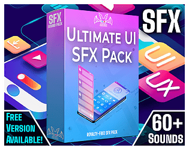

# 2. Button Hover Tick

Very soft tick (10-40 ms), lower volume than click. Use sparingly on desktop only.

**Roblox recipe (general knowledge, see docs below):** trigger from MouseEnter, throttle to once per 80 ms, skip on touch.

Back to the [SFX catalog](../SFX.md).

## Pictures

_Sound packs are audio, so no picture is available for this entry._ See the sources and searches below.

## Docs, cookbook and sources
- [Cookbook: UI sound bus](../../cookbook/sfx/04-ui-sound-bus.luau.md)
- [OpenGameArt: 87 Clickety Clips (CC0)](https://opengameart.org/content/87-clickety-clips)

## More previews (itch.io top results, credited)

Keyword-matched galleries. Click a gallery for 12 credited covers. These are search-style matches, not curated picks.

- [sound-effects + user-interface](../../previews/sound-effects-user-interface/README.md)

## Find more references
- [Google Images](https://www.google.com/search?tbm=isch&q=roblox+Button+Hover+Tick+sound+effect)
- [YouTube](https://www.youtube.com/results?search_query=roblox+Button+Hover+Tick+sound+effect)
- [Freesound](https://freesound.org/search/?q=Button+Hover+Tick+sound+effect)
- [itch.io audio](https://itch.io/game-assets/tag-sound-effects?q=Button+Hover+Tick+sound+effect)
