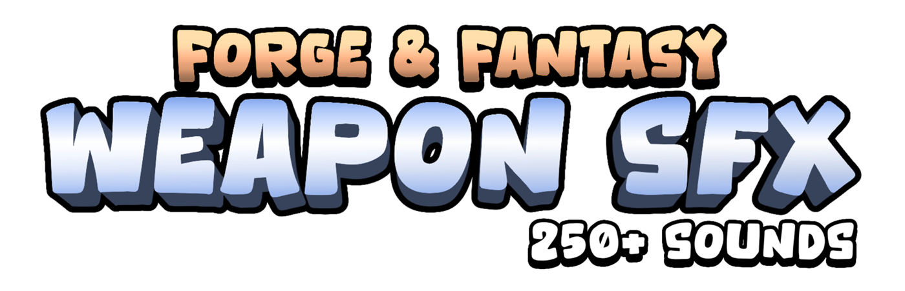

# 15. Sword Hit Metal

Metallic clang with short ring (200-500 ms).

**Roblox recipe (general knowledge, see docs below):** layer a low thud under the clang; play at the hit position.

Back to the [SFX catalog](../SFX.md).

## Pictures

*Forge & Fantasy Weapon SFX* by Case Portman, [source page](https://caseportman.itch.io/forge-fantasy-weapon-sfx). Preview image of the sound pack, all rights with the creator.

*Sci-Fi Swords Sound Pack* by Magic Sound Effects, [source page](https://magicsoundeffects.itch.io/sci-fi-swords-sound-pack). Preview image of the sound pack, all rights with the creator.

## Docs, cookbook and sources
- [Cookbook: positional sound](../../cookbook/sfx/03-positional-sound.luau.md)
- [Cookbook: play with variation](../../cookbook/sfx/01-play-with-variation.luau.md)

## More previews (itch.io top results, credited)

Keyword-matched galleries. Click a gallery for 12 credited covers. These are search-style matches, not curated picks.

- [sound-effects + swords](../../previews/sound-effects-swords/README.md)
- [sound-effects + weapons](../../previews/sound-effects-weapons/README.md)
- [sound-effects + whoosh](../../previews/sound-effects-whoosh/README.md)

## Find more references
- [Google Images](https://www.google.com/search?tbm=isch&q=roblox+Sword+Hit+Metal+sound+effect)
- [YouTube](https://www.youtube.com/results?search_query=roblox+Sword+Hit+Metal+sound+effect)
- [Freesound](https://freesound.org/search/?q=Sword+Hit+Metal+sound+effect)
- [itch.io audio](https://itch.io/game-assets/tag-sound-effects?q=Sword+Hit+Metal+sound+effect)
