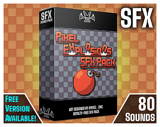

# 22. Explosion

Initial crack, low boom, long rumble tail (1-3 s).

**Roblox recipe (general knowledge, see docs below):** distance-based low-pass and delay for far players.

Back to the [SFX catalog](../SFX.md).

## Pictures

_Sound packs are audio, so no picture is available for this entry._ See the sources and searches below.

## Docs, cookbook and sources
- [API: EqualizerSoundEffect](../../official-docs/api/classes/EqualizerSoundEffect.yaml.md)
- [API: EchoSoundEffect](../../official-docs/api/classes/EchoSoundEffect.yaml.md)
- [Cookbook: positional sound](../../cookbook/sfx/03-positional-sound.luau.md)

## More previews (itch.io top results, credited)

Keyword-matched galleries. Click a gallery for 12 credited covers. These are search-style matches, not curated picks.

- [sound-effects + explosions](../../previews/sound-effects-explosions/README.md)
- [sound-effects + weapons](../../previews/sound-effects-weapons/README.md)

## Find more references
- [Google Images](https://www.google.com/search?tbm=isch&q=roblox+Explosion+sound+effect)
- [YouTube](https://www.youtube.com/results?search_query=roblox+Explosion+sound+effect)
- [Freesound](https://freesound.org/search/?q=Explosion+sound+effect)
- [itch.io audio](https://itch.io/game-assets/tag-sound-effects?q=Explosion+sound+effect)
