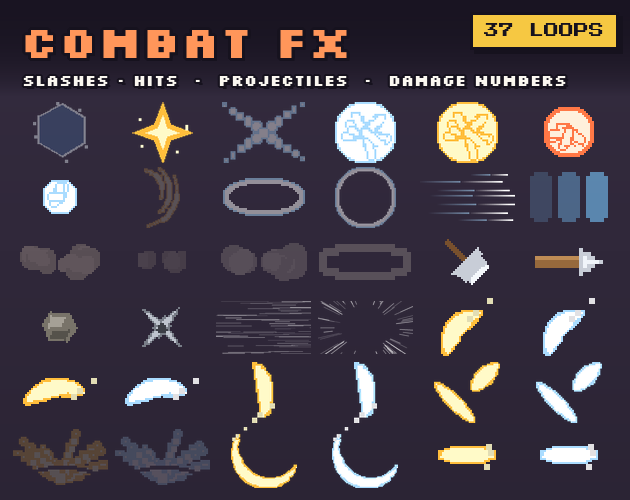

# 108. Damage Numbers

Floating numbers with crit scaling, colour by type, arc motion.

**Roblox recipe (from general Roblox knowledge, not tested in Studio):** BillboardGui pooled, tween up + fade.

Back to the [catalog](../GUI-STYLES.md).

## Pictures

*COMBAT FX* by GegX, [source page](https://gegx.itch.io/combat-fx). Preview image, all rights with the creator.

## Docs and references
- [Roblox docs: UI compatibility](https://create.roblox.com/docs/en-us/ui/styling/compatibility)
- [Game UI Database](https://www.gameuidatabase.com/about.php)

## Find more references
- [Google Images](https://www.google.com/search?tbm=isch&q=roblox+Damage+Numbers+GUI+style)
- [YouTube](https://www.youtube.com/results?search_query=roblox+Damage+Numbers+GUI+style)
- [Pinterest](https://www.pinterest.com/search/pins/?q=roblox+Damage+Numbers+GUI+style)
- [Behance](https://www.behance.net/search/projects?search=Damage+Numbers+GUI+style)
- [Dribbble](https://dribbble.com/search/Damage+Numbers+GUI+style)
