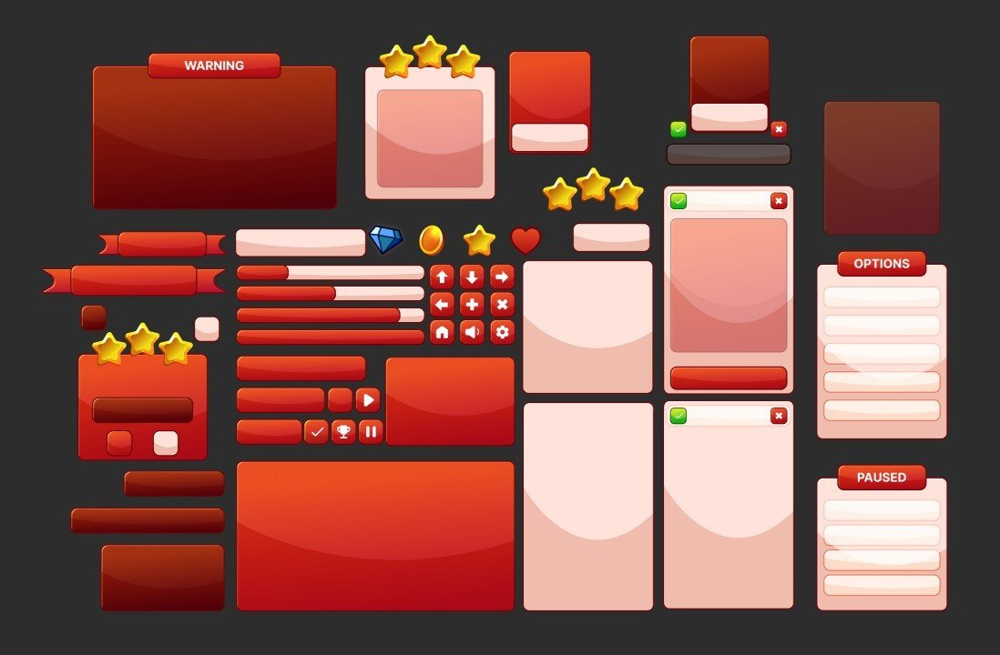

# 11. Glossy Bubble

White highlight ellipse on the upper third, drop shadow below. Refs: R13.

Back to the [style catalog](../GUI-STYLES.md).

## Pictures

*Casual Mobile Game UI Kit (Red Theme)* by nebuhanka, [source page](https://nebuhanka.itch.io/casual-mobile-game-ui-kit-red-theme). Resized preview, all rights with the creator.

*Casual Mobile Game UI Kit (Red Theme)* by nebuhanka, [source page](https://nebuhanka.itch.io/casual-mobile-game-ui-kit-red-theme). Resized preview, all rights with the creator.

## More previews (itch.io top results, credited)

Keyword-matched galleries. Click a gallery for 12 credited covers. These are search-style matches, not curated picks.

- [casual + user-interface](../../previews/casual-user-interface/README.md)

## Find more references

- [Google Images](https://www.google.com/search?tbm=isch&q=roblox+Glossy+Bubble+gui)
- [Pinterest](https://www.pinterest.com/search/pins/?q=roblox+Glossy+Bubble+gui)
- [Behance](https://www.behance.net/search/projects?search=Glossy+Bubble+game+ui)
- [Dribbble](https://dribbble.com/search/Glossy+Bubble+game+ui)
- [Game UI Database](https://www.gameuidatabase.com/)
