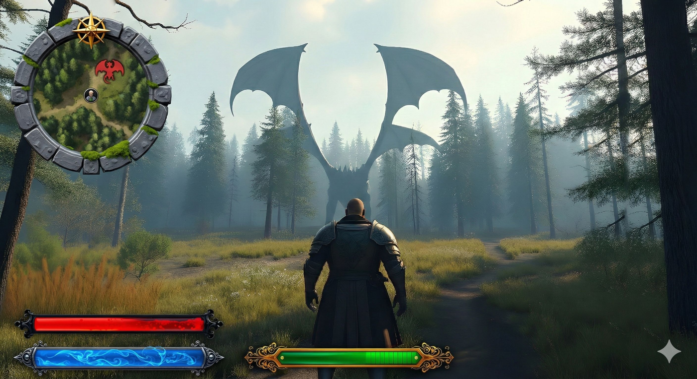

# 22. Modern Medieval

Parchment and iron, rarity labels, equip/sell buttons. Refs: R12.

Back to the [style catalog](../GUI-STYLES.md).

## Pictures

*Medieval Fantasy RPG UI Kit: Gothic & Gold* by Vill8tion, [source page](https://vill8tion.itch.io/medieval-fantasy-rpg-ui-kit-gothic-gold-4k). Resized preview, all rights with the creator.

*Medieval Fantasy RPG UI Kit: Gothic & Gold* by Vill8tion, [source page](https://vill8tion.itch.io/medieval-fantasy-rpg-ui-kit-gothic-gold-4k). Resized preview, all rights with the creator.

*Medieval Fantasy RPG UI Kit: Gothic & Gold* by Vill8tion, [source page](https://vill8tion.itch.io/medieval-fantasy-rpg-ui-kit-gothic-gold-4k). Resized preview, all rights with the creator.

## More previews (itch.io top results, credited)

Keyword-matched galleries. Click a gallery for 12 credited covers. These are search-style matches, not curated picks.

- [medieval + user-interface](../../previews/medieval-user-interface/README.md)

## Find more references

- [Google Images](https://www.google.com/search?tbm=isch&q=roblox+Modern+Medieval+gui)
- [Pinterest](https://www.pinterest.com/search/pins/?q=roblox+Modern+Medieval+gui)
- [Behance](https://www.behance.net/search/projects?search=Modern+Medieval+game+ui)
- [Dribbble](https://dribbble.com/search/Modern+Medieval+game+ui)
- [Game UI Database](https://www.gameuidatabase.com/)
