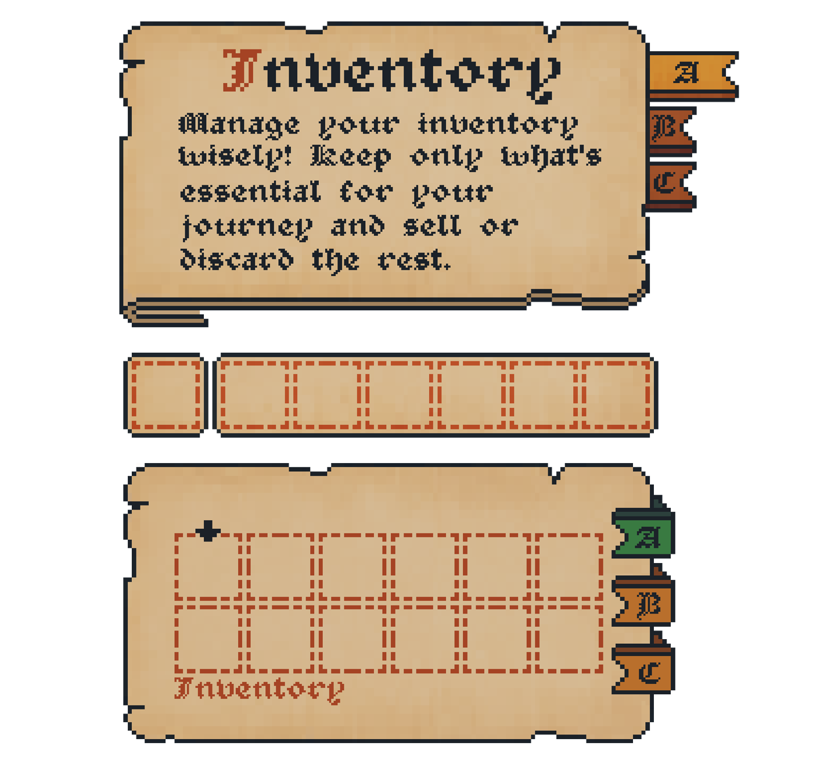

# 23. Parchment Scroll

Aged paper, serif font, wax-seal buttons. Refs: in-repo `visual-refs/icons/Scroll`, S.

Back to the [style catalog](../GUI-STYLES.md).

## Pictures

*Medieval Majesty GUI* by Finnmercury, [source page](https://finnmercury.itch.io/medieval-majesty). Resized preview, all rights with the creator.

*Medieval Majesty GUI* by Finnmercury, [source page](https://finnmercury.itch.io/medieval-majesty). Resized preview, all rights with the creator.

*Medieval Majesty GUI* by Finnmercury, [source page](https://finnmercury.itch.io/medieval-majesty). Resized preview, all rights with the creator.

## In this repo
See the [`visual-refs/icons/`](../../visual-refs/icons/_Folder%20Index.md) folder.

## More previews (itch.io top results, credited)

Keyword-matched galleries. Click a gallery for 12 credited covers. These are search-style matches, not curated picks.

- [medieval + user-interface](../../previews/medieval-user-interface/README.md)

## Find more references

- [Google Images](https://www.google.com/search?tbm=isch&q=roblox+Parchment+Scroll+gui)
- [Pinterest](https://www.pinterest.com/search/pins/?q=roblox+Parchment+Scroll+gui)
- [Behance](https://www.behance.net/search/projects?search=Parchment+Scroll+game+ui)
- [Dribbble](https://dribbble.com/search/Parchment+Scroll+game+ui)
- [Game UI Database](https://www.gameuidatabase.com/)
