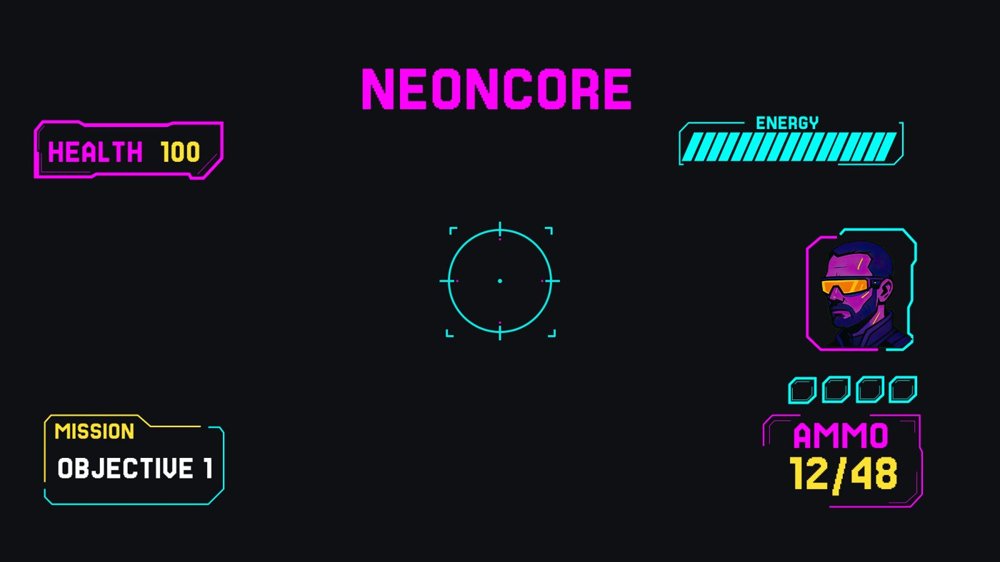
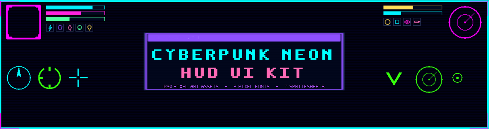

# 31. Neon Cyberpunk

Black base, cyan/magenta neon strokes with glow. Palette `#0A0A14 #00F0FF #FF2BD6`. Recipe: UIStroke plus a blurred duplicate. Refs: R13, S.

Back to the [style catalog](../GUI-STYLES.md).

## Pictures

*NEONCORE UI Pack* by Tonekya, [source page](https://tonekya.itch.io/neoncore-ui-pack). Resized preview, all rights with the creator.

*NEONCORE UI Pack* by Tonekya, [source page](https://tonekya.itch.io/neoncore-ui-pack). Resized preview, all rights with the creator.

*Cyberpunk Neon HUD UI Kit* by Hollow Pixel, [source page](https://hollow-pixel.itch.io/cyberpunk-neon-hud-ui-kit-280-pixel-ui-assets). Resized preview, all rights with the creator.

## More previews (itch.io top results, credited)

Keyword-matched galleries. Click a gallery for 12 credited covers. These are search-style matches, not curated picks.

- [cyberpunk + user-interface](../../previews/cyberpunk-user-interface/README.md)
- [neon + user-interface](../../previews/neon-user-interface/README.md)

## Find more references

- [Google Images](https://www.google.com/search?tbm=isch&q=roblox+Neon+Cyberpunk+gui)
- [Pinterest](https://www.pinterest.com/search/pins/?q=roblox+Neon+Cyberpunk+gui)
- [Behance](https://www.behance.net/search/projects?search=Neon+Cyberpunk+game+ui)
- [Dribbble](https://dribbble.com/search/Neon+Cyberpunk+game+ui)
- [Game UI Database](https://www.gameuidatabase.com/)
