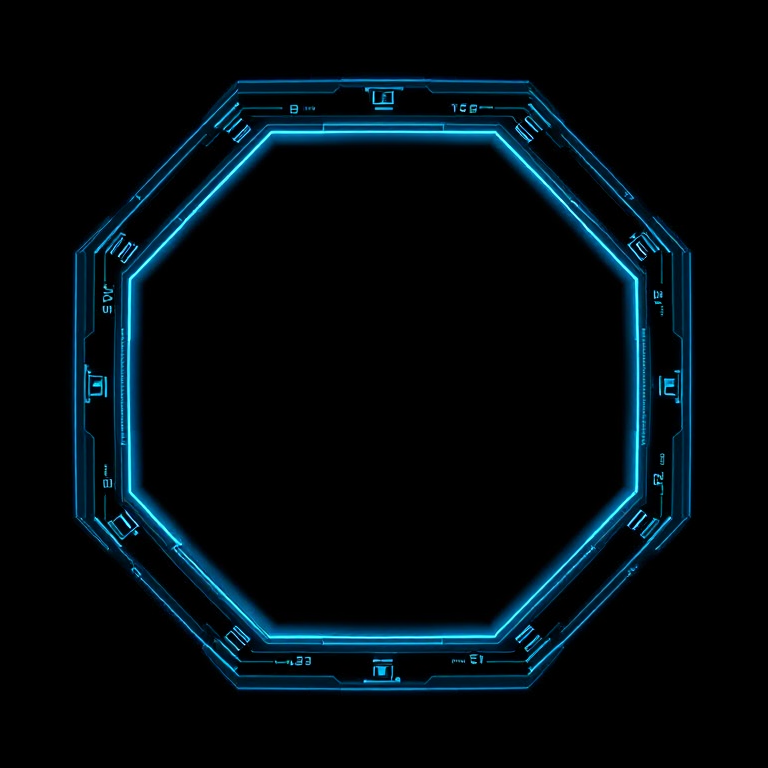

# 32. Holographic HUD

Transparent blue panels, thin lines, scanline overlay. Refs: S.

Back to the [style catalog](../GUI-STYLES.md).

## Pictures

*Cyberpunk UI Asset Pack v1* by DoDoCat, [source page](https://ckgndodocat.itch.io/cyberpunk-ui-asset-pack-v1). Resized preview, all rights with the creator.

*Sci-Fi Holographic HUD Kit* by Vill8tion, [source page](https://vill8tion.itch.io/sci-fi-holographic-hud-kit-cyberpunk-ui-4k). Resized preview, all rights with the creator.

*Sci-Fi Holographic HUD Kit* by Vill8tion, [source page](https://vill8tion.itch.io/sci-fi-holographic-hud-kit-cyberpunk-ui-4k). Resized preview, all rights with the creator.

## Find more references

- [Google Images](https://www.google.com/search?tbm=isch&q=roblox+Holographic+HUD+gui)
- [Pinterest](https://www.pinterest.com/search/pins/?q=roblox+Holographic+HUD+gui)
- [Behance](https://www.behance.net/search/projects?search=Holographic+HUD+game+ui)
- [Dribbble](https://dribbble.com/search/Holographic+HUD+game+ui)
- [Game UI Database](https://www.gameuidatabase.com/)
