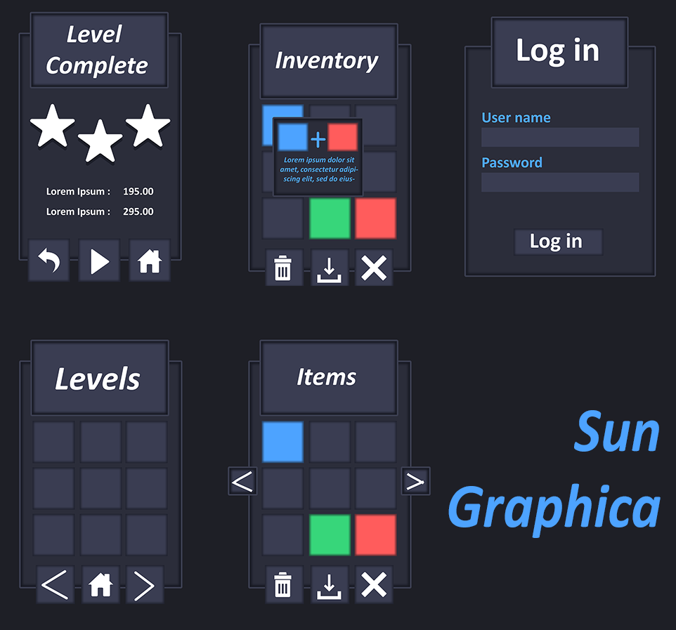

# 43. Dark Mode Pro

Near-black cards, one accent. Palette `#0E0F13 #1A1C23 #5B8CFF`. Refs: R18.

Back to the [style catalog](../GUI-STYLES.md).

## Pictures

*Modern Dark UI Kit* by VantUI, [source page](https://vantui.itch.io/modern-dark-ui-kit). Resized preview, all rights with the creator.

*Minimal Game UI Kit + 260 Icons* by SunGraphica, [source page](https://sungraphica.itch.io/clean-and-minimal-game-ui-kit-260-icons). Resized preview, all rights with the creator.

*Minimal Game UI Kit + 260 Icons* by SunGraphica, [source page](https://sungraphica.itch.io/clean-and-minimal-game-ui-kit-260-icons). Resized preview, all rights with the creator.

*Minimal Game UI Kit + 260 Icons* by SunGraphica, [source page](https://sungraphica.itch.io/clean-and-minimal-game-ui-kit-260-icons). Resized preview, all rights with the creator.

## More previews (itch.io top results, credited)

Keyword-matched galleries. Click a gallery for 12 credited covers. These are search-style matches, not curated picks.

- [gothic + user-interface](../../previews/gothic-user-interface/README.md)
- [dark + user-interface](../../previews/dark-user-interface/README.md)
- [minimal + user-interface](../../previews/minimal-user-interface/README.md)

## Find more references

- [Google Images](https://www.google.com/search?tbm=isch&q=roblox+Dark+Mode+Pro+gui)
- [Pinterest](https://www.pinterest.com/search/pins/?q=roblox+Dark+Mode+Pro+gui)
- [Behance](https://www.behance.net/search/projects?search=Dark+Mode+Pro+game+ui)
- [Dribbble](https://dribbble.com/search/Dark+Mode+Pro+game+ui)
- [Game UI Database](https://www.gameuidatabase.com/)
