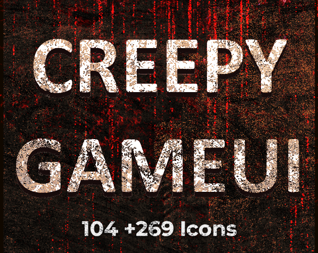
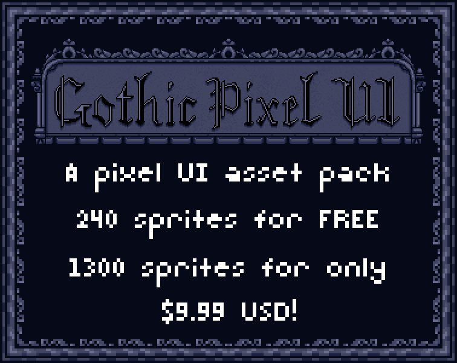

# 52. Gothic Horror

Blood red on black, ornate serif, cracked-glass border. Refs: S.

Back to the [style catalog](../GUI-STYLES.md).

## Pictures

> Closest matches found: rusted-metal horror UI and a gothic pixel UI.

*Horror Game UI Creator Kit* by SunGraphica, [source page](https://sungraphica.itch.io/creepy-game-ui). Resized preview, all rights with the creator.

*Horror Game UI Creator Kit* by SunGraphica, [source page](https://sungraphica.itch.io/creepy-game-ui). Resized preview, all rights with the creator.

*Gothic Pixel UI* by AbyssOwl, [source page](https://abyssowl.itch.io/gothic-pixel-ui). Resized preview, all rights with the creator.

*Gothic Pixel UI* by AbyssOwl, [source page](https://abyssowl.itch.io/gothic-pixel-ui). Resized preview, all rights with the creator.

## More previews (itch.io top results, credited)

Keyword-matched galleries. Click a gallery for 12 credited covers. These are search-style matches, not curated picks.

- [horror + user-interface](../../previews/horror-user-interface/README.md)
- [gothic + user-interface](../../previews/gothic-user-interface/README.md)

## Find more references

- [Google Images](https://www.google.com/search?tbm=isch&q=roblox+Gothic+Horror+gui)
- [Pinterest](https://www.pinterest.com/search/pins/?q=roblox+Gothic+Horror+gui)
- [Behance](https://www.behance.net/search/projects?search=Gothic+Horror+game+ui)
- [Dribbble](https://dribbble.com/search/Gothic+Horror+game+ui)
- [Game UI Database](https://www.gameuidatabase.com/)
