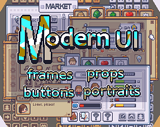

# 57. Pixel Art Retro

Integer-scaled pixel frames, bitmap font, limited palette. Recipe: ImageLabel with `ResampleMode = Pixelated`. Refs: R14.

Back to the [style catalog](../GUI-STYLES.md).

## Pictures

> pixelblox-1 is a Roblox-targeted pixel GUI pack.

*PixelBlox Vol. 1 (Roblox pixel GUI)* by BloxBuilders, [source page](https://bloxbuilders.itch.io/pixelblox-vol1). Resized preview, all rights with the creator.

*RPG UI Asset Pack (Pixel Art)* by pluguezada / CodeLoot, [source page](https://pluguezada.itch.io/rpg-ui-asset-pack-pixel-art-32128px-codeloot). Resized preview, all rights with the creator.

## More previews (itch.io top results, credited)

Keyword-matched galleries. Click a gallery for 12 credited covers. These are search-style matches, not curated picks.

- [pixel-art + user-interface](../../previews/pixel-art-user-interface/README.md)
- [retro + user-interface](../../previews/retro-user-interface/README.md)

## Find more references

- [Google Images](https://www.google.com/search?tbm=isch&q=roblox+Pixel+Art+Retro+gui)
- [Pinterest](https://www.pinterest.com/search/pins/?q=roblox+Pixel+Art+Retro+gui)
- [Behance](https://www.behance.net/search/projects?search=Pixel+Art+Retro+game+ui)
- [Dribbble](https://dribbble.com/search/Pixel+Art+Retro+game+ui)
- [Game UI Database](https://www.gameuidatabase.com/)
