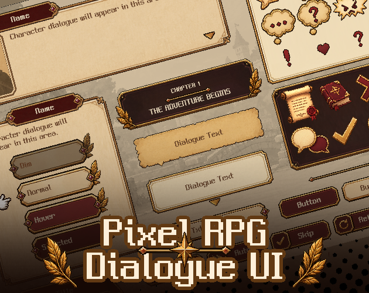
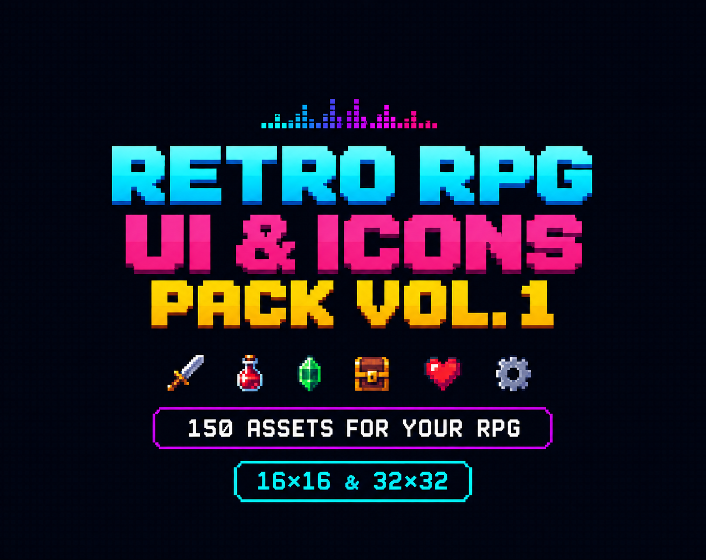

# 59. 16-bit JRPG Box

Blue gradient dialogue box with white border. Refs: R14, S.

Back to the [style catalog](../GUI-STYLES.md).

## Pictures

> Dialogue-box and RPG panel references.

*Pixel RPG Dialogue UI* by IndigoLay, [source page](https://indigolay.itch.io/pixel-rpg-dialogue-ui). Resized preview, all rights with the creator.

*Retro RPG UI & Icons Pack Vol. 1* by Molinus66, [source page](https://molinus66.itch.io/retro-rpg-ui-icons-pack-vol-1). Resized preview, all rights with the creator.

*Retro RPG UI & Icons Pack Vol. 1* by Molinus66, [source page](https://molinus66.itch.io/retro-rpg-ui-icons-pack-vol-1). Resized preview, all rights with the creator.

## More previews (itch.io top results, credited)

Keyword-matched galleries. Click a gallery for 12 credited covers. These are search-style matches, not curated picks.

- [pixel-art + user-interface](../../previews/pixel-art-user-interface/README.md)
- [retro + user-interface](../../previews/retro-user-interface/README.md)

## Find more references

- [Google Images](https://www.google.com/search?tbm=isch&q=roblox+16-bit+JRPG+Box+gui)
- [Pinterest](https://www.pinterest.com/search/pins/?q=roblox+16-bit+JRPG+Box+gui)
- [Behance](https://www.behance.net/search/projects?search=16-bit+JRPG+Box+game+ui)
- [Dribbble](https://dribbble.com/search/16-bit+JRPG+Box+game+ui)
- [Game UI Database](https://www.gameuidatabase.com/)
