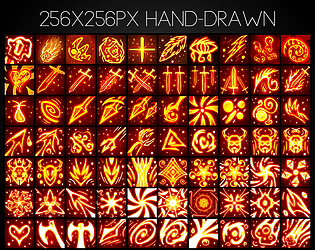

# 61. Hand-Drawn Sketch

Wobbly outlines, paper background, crayon fill. Refs: S.

Back to the [style catalog](../GUI-STYLES.md).

## Pictures

_No verified reference image was found for this style yet._ Use the searches below, and add images here with a source link.

## More previews (itch.io top results, credited)

Keyword-matched galleries. Click a gallery for 12 credited covers. These are search-style matches, not curated picks.

- [hand-drawn + user-interface](../../previews/hand-drawn-user-interface/README.md)

## Find more references

- [Google Images](https://www.google.com/search?tbm=isch&q=roblox+Hand-Drawn+Sketch+gui)
- [Pinterest](https://www.pinterest.com/search/pins/?q=roblox+Hand-Drawn+Sketch+gui)
- [Behance](https://www.behance.net/search/projects?search=Hand-Drawn+Sketch+game+ui)
- [Dribbble](https://dribbble.com/search/Hand-Drawn+Sketch+game+ui)
- [Game UI Database](https://www.gameuidatabase.com/)
