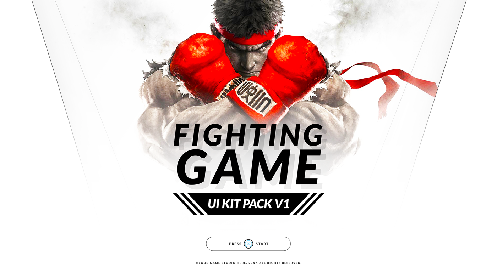
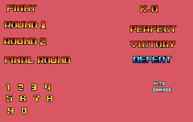

# 66. Fighting Game

Big health bars with timer, combo counter, VS screen. Refs: R16.

Back to the [style catalog](../GUI-STYLES.md).

## Pictures

> Pixel and flat fighting-game HUD and screen references.

*Fighting Game UIKit Pack V1* by rupertBastos, [source page](https://rupertbastos.itch.io/fighting-game-uikit-pack-v1). Resized preview, all rights with the creator.

*Fighting Game UIKit Pack V1* by rupertBastos, [source page](https://rupertbastos.itch.io/fighting-game-uikit-pack-v1). Resized preview, all rights with the creator.

*Fighting Game HUD/UI and Texts* by Richard Macedo, [source page](https://richard-macedo.itch.io/fighting-game-hudui-and-texts). Resized preview, all rights with the creator.

## More previews (itch.io top results, credited)

Keyword-matched galleries. Click a gallery for 12 credited covers. These are search-style matches, not curated picks.

- [fighting + user-interface](../../previews/fighting-user-interface/README.md)

## Find more references

- [Google Images](https://www.google.com/search?tbm=isch&q=roblox+Fighting+Game+gui)
- [Pinterest](https://www.pinterest.com/search/pins/?q=roblox+Fighting+Game+gui)
- [Behance](https://www.behance.net/search/projects?search=Fighting+Game+game+ui)
- [Dribbble](https://dribbble.com/search/Fighting+Game+game+ui)
- [Game UI Database](https://www.gameuidatabase.com/)
