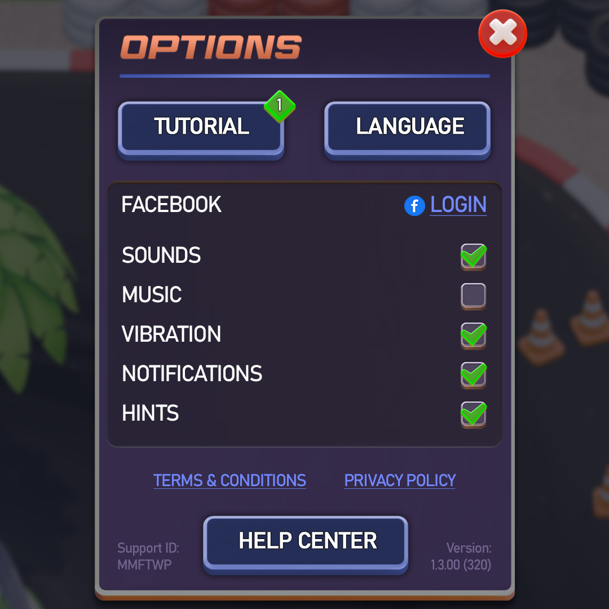

# 68. Racing Dashboard

As #40 plus a lap/position tower. Refs: R16.

Back to the [style catalog](../GUI-STYLES.md).

## Pictures

> Racing dashboard and result-screen references.

*Racing UI Kit* by Ville Seppänen, [source page](https://villesep.itch.io/racing-ui-kit). Resized preview, all rights with the creator.

*Racing UI Kit* by Ville Seppänen, [source page](https://villesep.itch.io/racing-ui-kit). Resized preview, all rights with the creator.

*Racing UI Kit* by Ville Seppänen, [source page](https://villesep.itch.io/racing-ui-kit). Resized preview, all rights with the creator.

## More previews (itch.io top results, credited)

Keyword-matched galleries. Click a gallery for 12 credited covers. These are search-style matches, not curated picks.

- [medieval + user-interface](../../previews/medieval-user-interface/README.md)
- [minimal + user-interface](../../previews/minimal-user-interface/README.md)
- [racing + user-interface](../../previews/racing-user-interface/README.md)

## Find more references

- [Google Images](https://www.google.com/search?tbm=isch&q=roblox+Racing+Dashboard+gui)
- [Pinterest](https://www.pinterest.com/search/pins/?q=roblox+Racing+Dashboard+gui)
- [Behance](https://www.behance.net/search/projects?search=Racing+Dashboard+game+ui)
- [Dribbble](https://dribbble.com/search/Racing+Dashboard+game+ui)
- [Game UI Database](https://www.gameuidatabase.com/)
