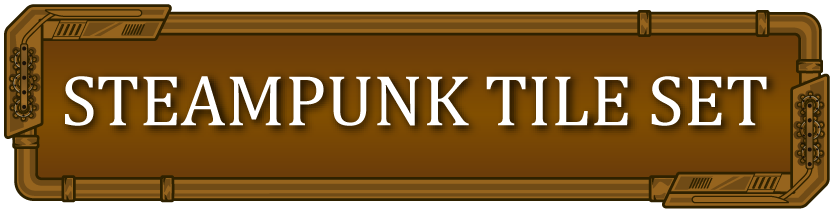

# 73. Steampunk Brass

Brass plates, rivets, gears and gauges on dark leather. Palette `#B8862B #3A2A1A #E8D8A0`.

**Roblox recipe (from general Roblox knowledge, not tested in Studio):** Frame + brass UIGradient, UIStroke dark brown, rotating gear ImageLabels via RenderStepped (cheap) or Tween.

Back to the [catalog](../GUI-STYLES.md).

## Pictures

*Steampunk Game GUI* by pzUH, [source page](https://pzuh.itch.io/steampunk-game-gui). Preview image, all rights with the creator.

*Steampunk UI* by GabrielaTot, [source page](https://gabrielatot.itch.io/steampunk-ui). Preview image, all rights with the creator.

*Steampunk UI* by GabrielaTot, [source page](https://gabrielatot.itch.io/steampunk-ui). Preview image, all rights with the creator.

## Docs and references
- [Roblox docs: UI appearance modifiers](https://create.roblox.com/docs/en-us/ui/appearance-modifiers)
- [creation.dev: Roblox UI best practices](https://www.creation.dev/blog/roblox-ui-design-best-practices)

## Find more references
- [Google Images](https://www.google.com/search?tbm=isch&q=roblox+Steampunk+Brass+GUI+style)
- [YouTube](https://www.youtube.com/results?search_query=roblox+Steampunk+Brass+GUI+style)
- [Pinterest](https://www.pinterest.com/search/pins/?q=roblox+Steampunk+Brass+GUI+style)
- [Behance](https://www.behance.net/search/projects?search=Steampunk+Brass+GUI+style)
- [Dribbble](https://dribbble.com/search/Steampunk+Brass+GUI+style)
