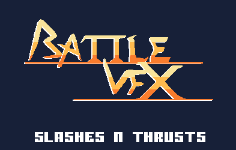
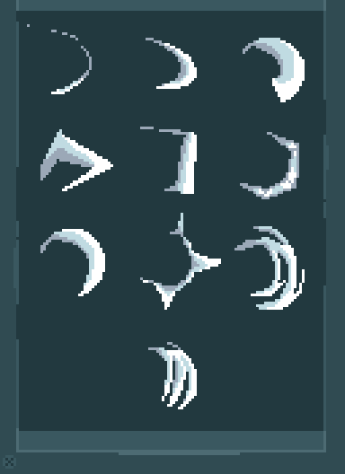

# 2. Slash Arc Trail

Crescent smear following a swing.

**Roblox recipe (from general Roblox knowledge, not tested in Studio):** Trail between two attachments on the blade, or a mesh arc faded with tween.

Back to the [catalog](../VFX.md).

## Pictures

*Pixel Art Sword VFX* by metpxl, [source page](https://metpxl.itch.io/pixel-art-sword-vfx-attack-slash-animation-pack). Preview image, all rights with the creator.

*Battle VFX: Slashes and Thrusts* by pimen, [source page](https://pimen.itch.io/battle-vfx-slashes-and-thrusts). Preview image, all rights with the creator.

*Battle VFX: Slashes and Thrusts* by pimen, [source page](https://pimen.itch.io/battle-vfx-slashes-and-thrusts). Preview image, all rights with the creator.

## Docs and references
- [Roblox docs: Trail](https://create.roblox.com/docs/reference/engine/classes/Trail)

## More previews (itch.io top results, credited)

Keyword-matched galleries. Click a gallery for 12 credited covers. These are search-style matches, not curated picks.

- [sprite-sheet + effects](../../previews/sprite-sheet-effects/README.md)

## Find more references
- [Google Images](https://www.google.com/search?tbm=isch&q=roblox+Slash+Arc+Trail+vfx)
- [YouTube](https://www.youtube.com/results?search_query=roblox+Slash+Arc+Trail+vfx)
- [Pinterest](https://www.pinterest.com/search/pins/?q=roblox+Slash+Arc+Trail+vfx)
- [Behance](https://www.behance.net/search/projects?search=Slash+Arc+Trail+vfx)
- [Dribbble](https://dribbble.com/search/Slash+Arc+Trail+vfx)
