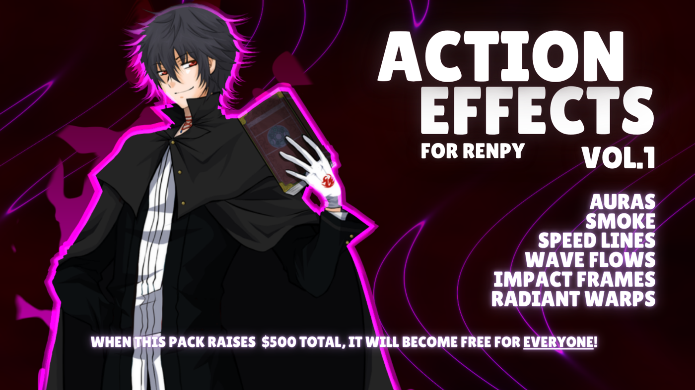

# 5. Anime Impact Frame

One-frame high-contrast inverted flash on a big hit.

**Roblox recipe (from general Roblox knowledge, not tested in Studio):** full-screen white/black Frame for 1-2 frames plus ColorCorrection.

Back to the [catalog](../VFX.md).

## Pictures

*Action Effects (Make Visual Novels)* by Stella @ MakeVisualNovels, [source page](https://makevisualnovels.itch.io/actfx). Preview image, all rights with the creator.

## More previews (itch.io top results, credited)

Keyword-matched galleries. Click a gallery for 12 credited covers. These are search-style matches, not curated picks.

- [vfx + hit](../../previews/vfx-hit/README.md)
- [effects + impact](../../previews/effects-impact/README.md)

## Find more references
- [Google Images](https://www.google.com/search?tbm=isch&q=roblox+Anime+Impact+Frame+vfx)
- [YouTube](https://www.youtube.com/results?search_query=roblox+Anime+Impact+Frame+vfx)
- [Pinterest](https://www.pinterest.com/search/pins/?q=roblox+Anime+Impact+Frame+vfx)
- [Behance](https://www.behance.net/search/projects?search=Anime+Impact+Frame+vfx)
- [Dribbble](https://dribbble.com/search/Anime+Impact+Frame+vfx)
