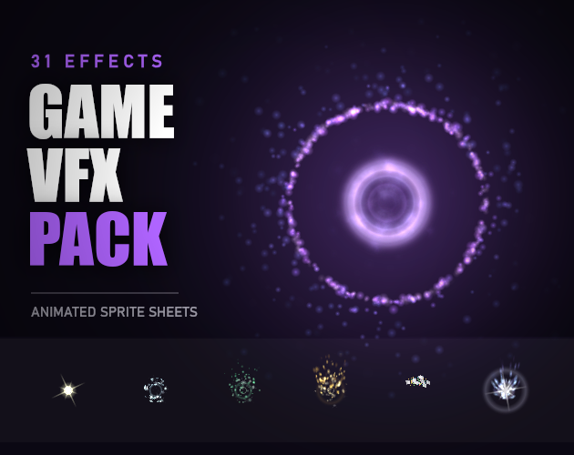

# 10. Heal Aura

Rising green sparkles and soft glow.

**Roblox recipe (from general Roblox knowledge, not tested in Studio):** ParticleEmitter upward Speed, LightEmission 0.5.

Back to the [catalog](../VFX.md).

## Pictures

*Essential VFX Pack, 31 Animated Effects* by Bonkiloki, [source page](https://bonkiloki.itch.io/essential-vfx-pack-31-animated-effects). Preview image, all rights with the creator.

## More previews (itch.io top results, credited)

Keyword-matched galleries. Click a gallery for 12 credited covers. These are search-style matches, not curated picks.

- [vfx + magic](../../previews/vfx-magic/README.md)

## Find more references
- [Google Images](https://www.google.com/search?tbm=isch&q=roblox+Heal+Aura+vfx)
- [YouTube](https://www.youtube.com/results?search_query=roblox+Heal+Aura+vfx)
- [Pinterest](https://www.pinterest.com/search/pins/?q=roblox+Heal+Aura+vfx)
- [Behance](https://www.behance.net/search/projects?search=Heal+Aura+vfx)
- [Dribbble](https://dribbble.com/search/Heal+Aura+vfx)
