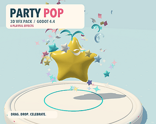

# 29. Confetti Celebration

Multi-colour falling pieces.

**Roblox recipe (from general Roblox knowledge, not tested in Studio):** emitter with ColorSequence random keypoints, gravity.

Back to the [catalog](../VFX.md).

## Pictures

_No verified reference image was found for this entry yet._ Use the searches below.

## More previews (itch.io top results, credited)

Keyword-matched galleries. Click a gallery for 12 credited covers. These are search-style matches, not curated picks.

- [vfx + confetti](../../previews/vfx-confetti/README.md)

## Find more references
- [Google Images](https://www.google.com/search?tbm=isch&q=roblox+Confetti+Celebration+vfx)
- [YouTube](https://www.youtube.com/results?search_query=roblox+Confetti+Celebration+vfx)
- [Pinterest](https://www.pinterest.com/search/pins/?q=roblox+Confetti+Celebration+vfx)
- [Behance](https://www.behance.net/search/projects?search=Confetti+Celebration+vfx)
- [Dribbble](https://dribbble.com/search/Confetti+Celebration+vfx)
