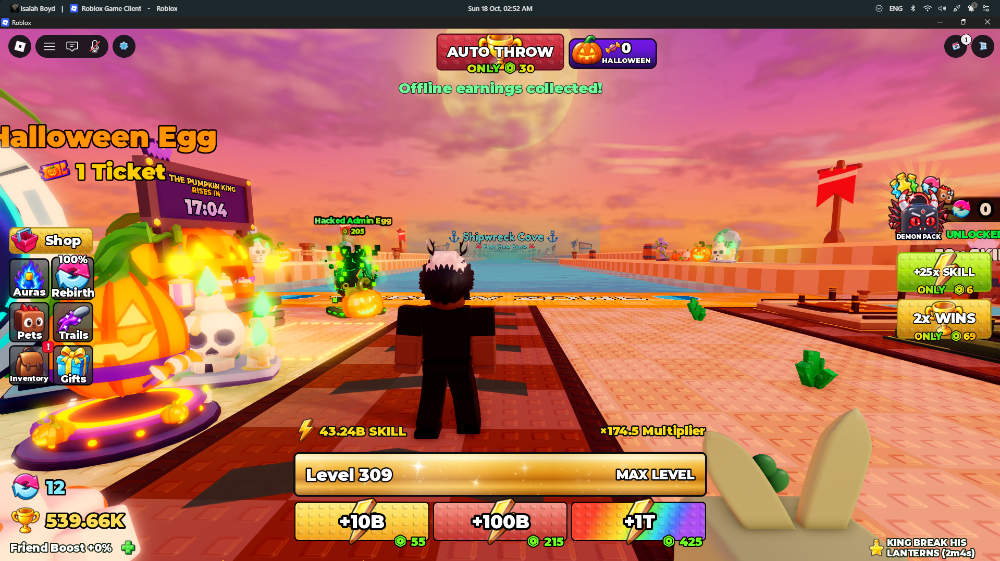
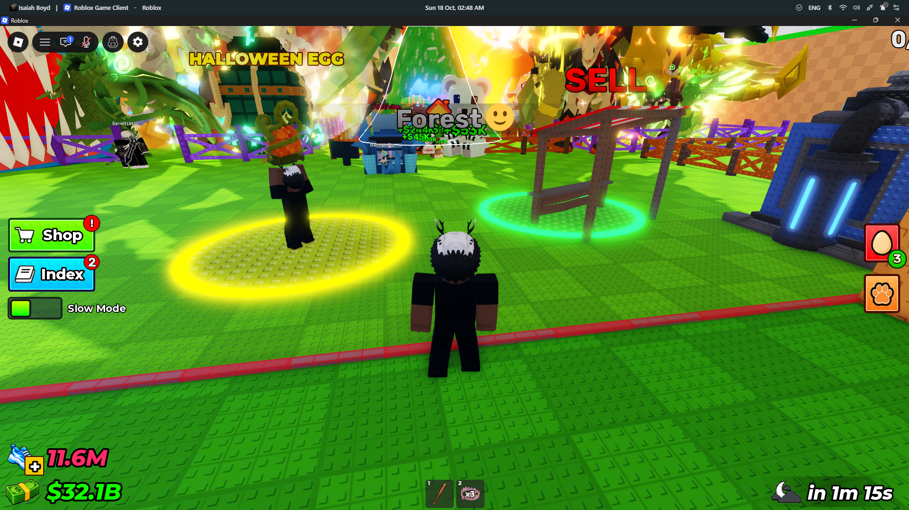

# Authentic Roblox stud UI references

This folder curates **real creator-published studded Roblox UI examples**, not AI-generated lookalikes.

## Local screenshots (7 PNG files)

These are the **seven pre-existing image files** in this folder. Their original creators and redistribution permissions have not been independently verified, so treat them as visual study references until their provenance is documented.

| Local file | Preview |
| --- | --- |
| [Stud-Buttons.png](Stud-Buttons.png) |  |
| [Stud-DailyRewards.png](Stud-DailyRewards.png) |  |
| [Stud-GUI-1.png](Stud-GUI-1.png) |  |
| [Stud-GUI-2.png](Stud-GUI-2.png) |  |
| [Stud-GUI-4.png](Stud-GUI-4.png) |  |
| [Stud-GUI-5.png](Stud-GUI-5.png) |  |
| [Stud-Shop.png](Stud-Shop.png) |  |

## Creator-published stud UI references (external sources)

These links point to actual Roblox UI projects, packs, and screenshots published by their creators. **External references are not bundled image assets**. Do not mirror preview images or redistribute paid/free kits unless their license allows it.

| Actual source | Creator / platform | What to study | Access |
| --- | --- | --- | --- |
| [Studded UI Free Roblox UI Kit](https://rblx-essentials.itch.io/studded-ui) | RBLX Essentials / itch.io | 14 actual editable menus, shop, trade, rewards, buttons, Studio captures | Free; redistribution restricted |
| [StudUI Lite](https://semajh.itch.io/studui-lite) | The Crypt Studios / itch.io | Studio-built stud UI: HUD, shop, daily, codes, ranks, settings | Free download; verify license |
| [Studded GUI Kit UI Theme Custom Buttons](https://create.roblox.com/store/asset/92606407843486/Studded-GUI-Kit-UI-Theme-Custom-Buttons) | @Novan7PrimalS / Roblox Creator Store | Studio model: custom studded controls and buttons | Creator Store model |
| [UXR Stud UI Pack](https://create.roblox.com/store/asset/124454018303868/UXR-Stud-UI-Pack) | @siracozmen01 / Roblox Creator Store | 45+ interface layouts: shop, upgrades, trades, leaderboards | Paid; view listing only |
| [Complete Stud UI Kit](https://builtbybit.com/resources/complete-stud-ui-kit.126952/) | jacobd / BuiltByBit | Real Studio screenshots: HUD, shop, inventory, progress, hotbar | Paid; view previews only |
| [Stud UI Kit 2](https://builtbybit.com/resources/stud-ui-kit-2.128788/) | JacobVeD / BuiltByBit | HUD, notifications, leaderboard, rewards and shop panels | Paid; view previews only |
| [Stud UI Kit: Shop, Daily, Codes, Rebirth](https://assetsfactory.itch.io/roblox-stud-ui-kit) | AssetsFactory / itch.io | Functional native Roblox Studio stud GUI with editable panels | Paid; view previews only |
| [StudUI](https://semajh.itch.io/studui) | The Crypt Studios / itch.io | Shop, game passes, daily rewards, codes and leaderboard UI | Paid; view previews only |
| [Sunny Side Roblox Stud UI Kit](https://embedary.tech/resources/sunny-side) | Embedary / creator website | Real Roblox UI captures, animated shop, rewards and menus | View creator gallery |

## Important quality rules

- **A reference must come from a real, identified creator/project.** Invented SVG concepts and generative mockups do **not** qualify.
- Include the original source and creator with any new entry. Attribute the visual where possible.
- Distinguish preview-only external links from locally stored PNGs and usable Roblox model files.
- Do not imply a free download permits redistribution. Follow the creator's license, particularly for commercial assets.
- The number of external sources above is **9**; the seven existing PNGs are **7 files**, not 7 newly sourced/verified creators.

## Stud UI design features to examine

Stud-tiled surfaces, heavy dark outlines, inset or extruded buttons, white-bordered panels, colorful header bars, consistent coin/reward icons, and mobile-readable layouts. These are **observations about design language**, not claims that the files here are redistributable.

For implementation, refer to [Roblox UI documentation](https://create.roblox.com/docs/ui) and build interface instances natively in Studio.
